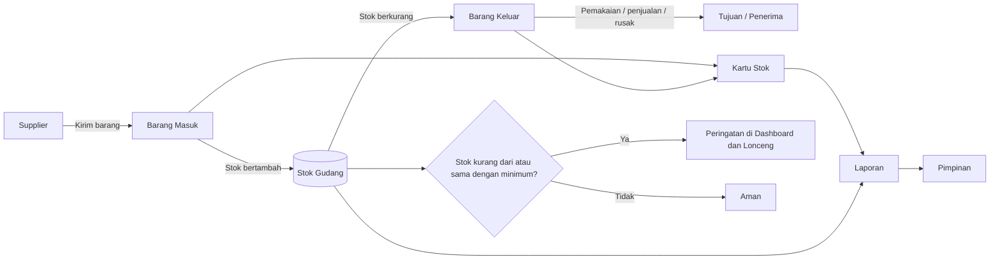
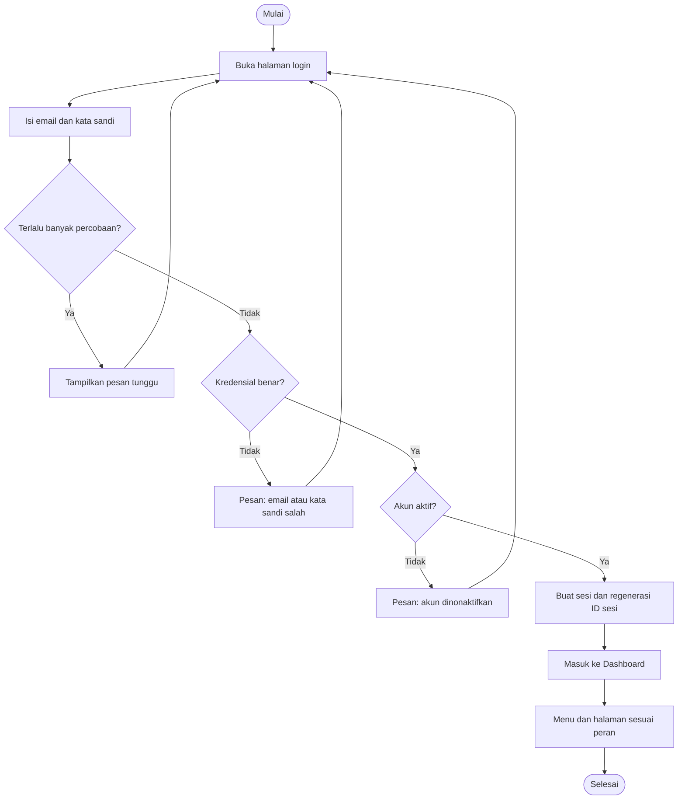
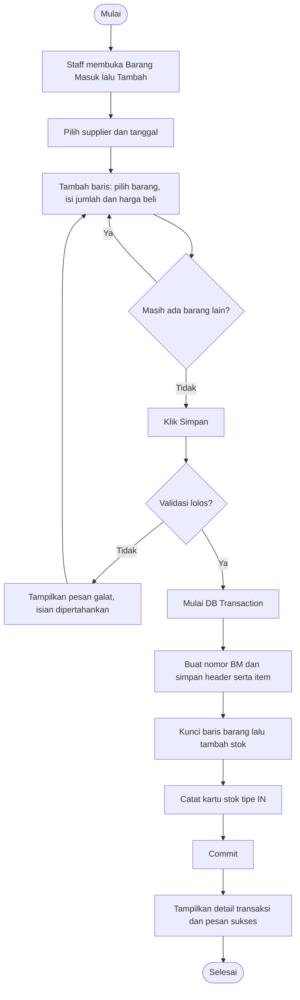
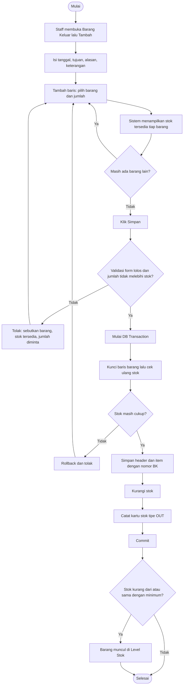
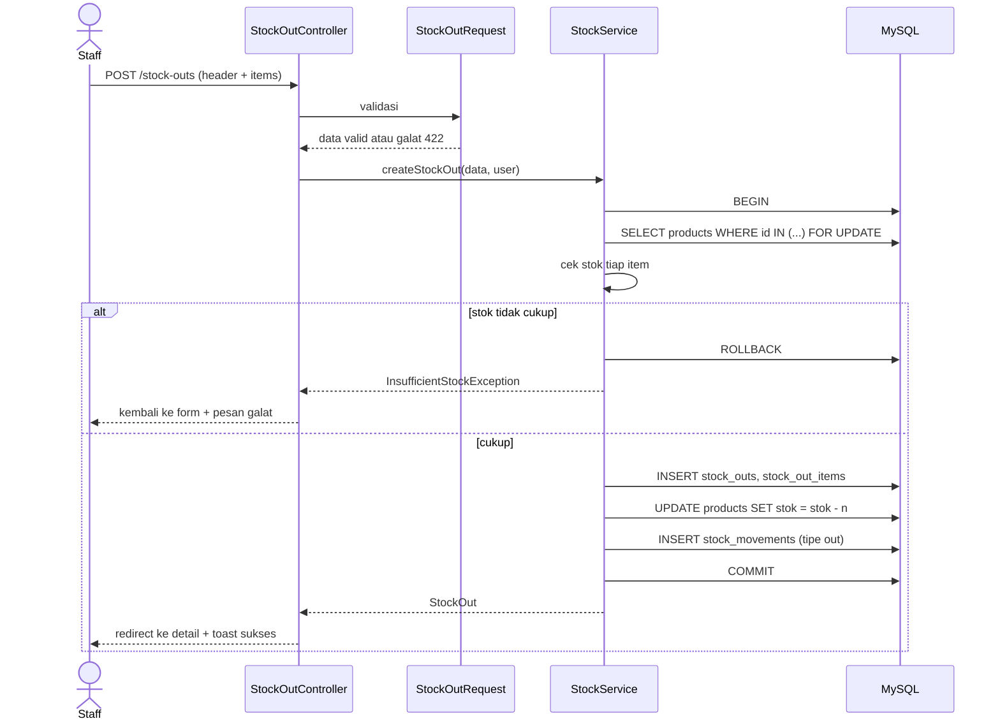
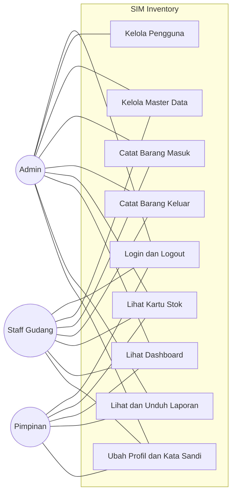

# PRD — Sistem Informasi Inventory Stok Barang (SIM Inventory)

| | |
|---|---|
| **Nama Produk** | SIM Inventory (Sistem Informasi Inventory Stok Barang) |
| **Versi Dokumen** | 1.1 |
| **Tanggal** | 2 November 2026 |
| **Penyusun** | Khoirul — Prodi Sistem Informasi, Universitas Muria Kudus |
| **Jenis Proyek** | Aplikasi web (tugas kuliah / proyek pembelajaran) |
| **Project (folder)** | `pw_project` (Laravel, dikerjakan di Antigravity IDE) |
| **Status** | Perancangan selesai, pengerjaan belum dimulai |

### Riwayat revisi

| Versi | Tanggal | Perubahan |
|---|---|---|
| 1.0 | 2 Nov 2026 | Draf awal: lingkup, alur bisnis, tech stack, database, UI/UX |
| 1.1 | 2 Nov 2026 | Ditambah: kondisi project saat ini dan analisis kesenjangan, spesifikasi field dan validasi, kriteria penerimaan per fitur, spesifikasi laporan, rumus dashboard, keamanan, kasus uji diperluas, UI diselaraskan dengan `DESIGN.md`. **Lampiran setup ditulis ulang sesuai kondisi project `pw_project`.** |

### Dokumen terkait

| File | Fungsi |
|---|---|
| `AGENTS.md` | Aturan kerja untuk agen AI (Antigravity): urutan fase, larangan, format laporan |
| `docs/DESIGN.md` | Panduan visual: token warna, komponen, tata letak (mengikuti gambar referensi dashboard) |
| `docs/PRD.md` | Dokumen ini: fungsi, data, alur bisnis |

**Aturan jika ada pertentangan:** fungsi dan data mengikuti PRD, visual mengikuti `DESIGN.md`, cara kerja mengikuti `AGENTS.md`.

---

## Daftar Isi

1. [Ringkasan Produk](#1-ringkasan-produk)
2. [Latar Belakang dan Tujuan](#2-latar-belakang-dan-tujuan)
3. [Ruang Lingkup](#3-ruang-lingkup)
4. [Kondisi Project Saat Ini dan Analisis Kesenjangan](#4-kondisi-project-saat-ini-dan-analisis-kesenjangan)
5. [Pengguna dan Hak Akses](#5-pengguna-dan-hak-akses)
6. [Kebutuhan Fungsional](#6-kebutuhan-fungsional)
7. [Spesifikasi Field dan Validasi](#7-spesifikasi-field-dan-validasi)
8. [Kebutuhan Non-Fungsional](#8-kebutuhan-non-fungsional)
9. [Alur Proses Bisnis](#9-alur-proses-bisnis)
10. [Tech Stack](#10-tech-stack)
11. [Arsitektur Aplikasi](#11-arsitektur-aplikasi)
12. [Struktur Database](#12-struktur-database)
13. [Aturan Bisnis](#13-aturan-bisnis)
14. [Rancangan UI/UX](#14-rancangan-uiux)
15. [Spesifikasi Laporan dan Ekspor](#15-spesifikasi-laporan-dan-ekspor)
16. [Daftar Route](#16-daftar-route)
17. [Keamanan](#17-keamanan)
18. [Rencana Pengujian](#18-rencana-pengujian)
19. [Rencana Pengerjaan](#19-rencana-pengerjaan)
20. [Risiko dan Mitigasi](#20-risiko-dan-mitigasi)
21. [Kriteria Penerimaan](#21-kriteria-penerimaan)
22. [Lampiran A: Setup Lingkungan Pengembangan](#22-lampiran-a-setup-lingkungan-pengembangan)
23. [Lampiran B: Katalog Pesan Sistem](#23-lampiran-b-katalog-pesan-sistem)
24. [Lampiran C: Data Demo (Seeder)](#24-lampiran-c-data-demo-seeder)

---

## 1. Ringkasan Produk

SIM Inventory adalah aplikasi web untuk mengelola persediaan barang di satu gudang. Aplikasi mencatat data barang, barang masuk dari supplier, dan barang keluar. Stok diperbarui otomatis dari setiap transaksi, dan semua pergerakan stok terekam dalam kartu stok.

Aplikasi memberi peringatan saat stok menipis dan menghasilkan laporan yang dapat diekspor ke PDF dan Excel. Akses dibatasi per peran: Admin, Staff Gudang, dan Pimpinan.

**Nilai utama:** stok yang selalu akurat, riwayat yang dapat ditelusuri, dan peringatan dini sebelum barang habis.

## 2. Latar Belakang dan Tujuan

### 2.1 Masalah yang diselesaikan

Pencatatan stok manual (buku atau spreadsheet) umumnya menimbulkan masalah berikut:

| # | Masalah | Dampak |
|---|---|---|
| M1 | Jumlah di catatan berbeda dengan stok fisik karena transaksi lupa dicatat atau salah hitung | Keputusan pengadaan salah, selisih stok |
| M2 | Barang kehabisan tanpa disadari, atau menumpuk berlebihan | Operasional terhambat atau pemborosan |
| M3 | Riwayat keluar masuk barang sulit dilacak, siapa melakukan apa dan kapan | Sulit mencari penyebab selisih |
| M4 | Pembuatan laporan memakan waktu karena direkap manual | Laporan terlambat dan rawan salah |
| M5 | Semua orang dapat mengubah catatan | Data tidak terjaga |

### 2.2 Tujuan produk

| # | Tujuan | Indikator keberhasilan (terukur) | Mengatasi |
|---|---|---|---|
| T1 | Stok selalu akurat dan diperbarui otomatis | Untuk setiap barang, `products.stok` = penjumlahan seluruh `stock_movements` (selisih 0 pada data uji) | M1 |
| T2 | Risiko kehabisan stok berkurang | Setiap barang dengan `stok <= stok_minimum` tampil di dashboard dan laporan, tanpa terkecuali | M2 |
| T3 | Riwayat dapat ditelusuri | Setiap perubahan stok memiliki pelaku, waktu, dan referensi transaksi (100% baris kartu stok) | M3 |
| T4 | Pelaporan cepat | Laporan dapat diunduh dalam maksimal 5 klik dari dashboard | M4 |
| T5 | Akses aman dan sesuai peran | Semua skenario uji hak akses (TC-30 s/d TC-36) lulus | M5 |

## 3. Ruang Lingkup

### 3.1 Dalam lingkup (Versi 1.0)

- Login, logout, profil, dan manajemen pengguna berbasis peran
- Master data: kategori, satuan, supplier, barang (dengan foto)
- Transaksi barang masuk dan barang keluar (multi-item)
- Kartu stok (riwayat pergerakan stok per barang)
- Dashboard ringkasan, grafik, dan peringatan stok minimum
- Empat laporan stok dan transaksi (layar, PDF, Excel)
- Antarmuka berbahasa Indonesia dan responsif

### 3.2 Di luar lingkup (pengembangan lanjutan)

| Fitur | Rencana |
|---|---|
| Stok opname (penyesuaian stok fisik) | Versi 1.1 |
| Cetak bukti transaksi (PDF per transaksi) | Versi 1.1 |
| Log aktivitas pengguna | Versi 1.1 |
| Multi-gudang dan transfer antar gudang | Tidak direncanakan |
| Barcode / QR scanner | Tidak direncanakan |
| Modul penjualan, kasir, faktur, purchase order | Tidak direncanakan |
| Integrasi akuntansi, valuasi persediaan (FIFO/rata-rata) | Tidak direncanakan |
| Aplikasi mobile native | Tidak direncanakan (web responsif sudah cukup) |
| Menu Stores, Billing, Orders, Delivery (ada di gambar referensi desain) | **Tidak dibuat**, hanya gaya visualnya yang dipakai |

### 3.3 Asumsi

- Satu gudang dengan satu lokasi penyimpanan.
- Aplikasi dijalankan di komputer lokal atau jaringan lokal memakai XAMPP.
- Satu barang memiliki satu satuan (tidak ada konversi satuan).
- Harga beli disimpan sebagai referensi, tidak ada valuasi persediaan.
- Pengguna adalah staf internal yang dikenal. Pendaftaran mandiri tidak tersedia.

### 3.4 Batasan

- Dikerjakan oleh satu orang dengan bantuan agen AI, sebagai tugas kuliah.
- Menggunakan lingkungan XAMPP di Windows 11.
- Hanya paket yang tercantum di bagian 10 yang boleh dipakai.

## 4. Kondisi Project Saat Ini dan Analisis Kesenjangan

### 4.1 Kondisi per 2 November 2026

Diambil dari tangkapan layar Antigravity IDE:

| Aspek | Kondisi |
|---|---|
| Nama folder project | `pw_project` |
| IDE | Antigravity IDE (agen berada di panel kanan) |
| Struktur | Skeleton Laravel standar: `app`, `bootstrap`, `config`, `database`, `public`, `resources`, `routes`, `storage`, `tests`, `vendor` |
| File root | `.editorconfig`, `.env`, `.env.example`, `.gitattributes`, `.gitignore`, `artisan`, `composer.json`, `composer.lock`, `package.json`, `phpunit.xml`, `README.md`, `vite.config.js` |
| Dependensi PHP | **Sudah terpasang** (`vendor` dan `composer.lock` ada) |
| Dependensi Node | **Belum terpasang** (tidak ada `node_modules` dan `package-lock.json`) |
| `.env` | Sudah ada, kemungkinan masih bawaan (lihat 4.3) |
| Kode buatan sendiri | Belum ada (project belum diubah) |
| Dokumen panduan agen | Belum ada (`AGENTS.md` dan `docs/` belum ditambahkan) |
| Konfigurasi Tailwind | Belum ada (`tailwind.config.js` dan `postcss.config.js` tidak ada) |
| Versi Laravel | **12.62.0** (terkonfirmasi 2 Nov 2026) · PHP 8.2.12 (XAMPP, ZTS) · Composer 2.10.1 · Node 24.15.0 · npm 11.12.1 |
| Paket tambahan | Belum ada yang diketahui terpasang pada tangkapan layar awal (lihat pembaruan 3 Nov di bawah) |

> Versi pasti dicek dengan `php artisan --version` (langkah A.2). Rancangan ini berlaku untuk Laravel 11, 12, dan 13. Perbedaannya dirangkum di 4.4.

**Pembaruan 3 November 2026 (persiapan A.1–A.7 selesai):**
- `.env` mengarah ke MySQL `inventory_stok`; migrasi bawaan dan migrasi Spatie sudah dijalankan.
- Breeze (Blade) terpasang; halaman `/login` tampil dengan gaya Tailwind lewat `http://localhost/pw_project/public/login`.
- Paket terpasang: Spatie Permission **6.25.0**, Laravel Excel **3.1.70** (PhpSpreadsheet 1.30.7), DomPDF **3.1.2** (dompdf 3.1.6), Blade Heroicons **2.7.0**.
- Karena PHP 8.2, rilis terbaru Spatie (8.x) dan Laravel Excel (4.x) yang butuh PHP 8.3 **tidak** terpasang. Composer otomatis memilih rilis yang cocok (hasil yang diharapkan).
- Belum dikerjakan: terjemahan `id`, paket npm (Chart.js, font Inter), `storage:link`, zona waktu, penempatan dokumen panduan.

### 4.2 Analisis kesenjangan (kondisi saat ini → target)

| # | Target | Kondisi saat ini | Tindakan | Fase |
|---|---|---|---|---|
| G1 | Database MySQL `inventory_stok` | Belum ada / `.env` mengarah ke SQLite bawaan | Buat database, ubah `.env`, `php artisan migrate` | 1 |
| G2 | Autentikasi (login, logout, profil) | Belum ada | Pasang Laravel Breeze (Blade) | 1 |
| G3 | Peran dan hak akses | Belum ada | Pasang Spatie Permission, seeder role | 1 |
| G4 | Tailwind CSS sesuai DESIGN.md | Belum ada konfigurasi | Dipasang oleh Breeze (Tailwind 3), lalu token DESIGN.md ditambahkan | 1 |
| G5 | Terjemahan Indonesia | Hanya bahasa Inggris, folder `lang` belum ada | `laravel-lang/common` atau berkas manual | 1 |
| G6 | Chart.js, font Inter, ikon | Belum ada | `npm install` paket, `composer require` ikon | 1 |
| G7 | Ekspor PDF dan Excel | Belum ada | DomPDF dan Laravel Excel | 5 |
| G8 | Tabel domain (9 tabel) | Hanya tabel bawaan Laravel | Migration baru | 1 |
| G9 | Dokumen panduan agen | Belum ada | Letakkan `AGENTS.md`, `docs/PRD.md`, `docs/DESIGN.md` | Sebelum fase 1 |
| G10 | Dependensi Node terpasang | Belum | `npm install` (dijalankan otomatis oleh Breeze) | 1 |

### 4.3 Hal yang perlu diperhatikan dari kondisi awal

1. **Database bawaan SQLite.** Skeleton Laravel 11/12 memakai `DB_CONNECTION=sqlite`, `SESSION_DRIVER=database`, `CACHE_STORE=database`, dan `QUEUE_CONNECTION=database`. Setelah `.env` diganti ke MySQL, tabel `sessions` dan `cache` **belum ada di MySQL** sampai `php artisan migrate` dijalankan. Selama itu, setiap halaman akan galat "Table 'inventory_stok.sessions' doesn't exist". Karena itu migrate dijalankan segera setelah `.env` diubah (langkah A.5).
2. **Breeze menimpa beberapa file.** `routes/web.php`, `vite.config.js`, `resources/css/app.css`, dan `resources/js/app.js` akan diganti. Aman karena project belum diubah, tetapi **pasang Breeze sebelum membuat kode lain**.
3. **Tailwind versi 3 dari Breeze.** Skeleton Laravel 12 membawa Tailwind 4 (`@tailwindcss/vite`), sedangkan Breeze (stack Blade) memasang Tailwind **3** beserta `tailwind.config.js` dan menimpa konfigurasi Vite. Proyek ini mengikuti Breeze (Tailwind 3), sehingga token warna ditulis di `tailwind.config.js` seperti pada `DESIGN.md` §3.2.
4. **Terminal Windows.** Terminal bawaan Antigravity biasanya PowerShell. Perintah di dokumen ini ditulis untuk **Command Prompt (cmd)** sesuai modul perkuliahan. Lihat langkah A.1.
5. **Nama folder `pw_project`** berbeda dengan nama aplikasi. Ini tidak masalah: nama aplikasi diatur lewat `APP_NAME="SIM Inventory"`, nama database `inventory_stok`.

### 4.4 Perbedaan antar versi Laravel yang relevan

| Aspek | Laravel 11 | Laravel 12 | Laravel 13 |
|---|---|---|---|
| PHP minimum | 8.2 | 8.2 | **8.3** |
| Dukungan perbaikan keamanan | s.d. 12 Mar 2026 (sudah berakhir) | s.d. 24 Feb 2027 | s.d. 17 Mar 2028 |
| Tailwind di skeleton | Tidak ada | v4 | v4 |
| Konfigurasi middleware | `bootstrap/app.php` | `bootstrap/app.php` | `bootstrap/app.php` |
| Berkas panduan agen bawaan | Tidak ada | Tidak ada | `AGENTS.md` dan `CLAUDE.md` (Laravel Boost) |
| Breeze | Didukung | Didukung | Didukung |

Sumber: dokumentasi rilis Laravel 13 (tabel *Support Policy*) dan berkas `composer.json` Breeze yang memuat `laravel/framework: ^11.0|^12.0|^13.0`.

Konsekuensi: jika `php artisan --version` menunjukkan **Laravel 11**, project tetap dapat dikerjakan, tetapi versi ini sudah tidak menerima perbaikan keamanan. Untuk tugas kuliah ini dapat diterima. Jika menunjukkan **Laravel 13** dan ada `AGENTS.md` bawaan, gabungkan isinya ke `AGENTS.md` proyek ini, jangan ditimpa buta.

## 5. Pengguna dan Hak Akses

### 5.1 Persona

| Persona | Peran sistem | Tujuan | Frustrasi saat ini | Kebutuhan utama |
|---|---|---|---|---|
| **Pak Admin** (pengelola sistem) | Admin | Sistem berjalan rapi dan data terkendali | Tidak tahu siapa mengubah apa | Kelola master data, akun, dan pantau seluruh aktivitas |
| **Mbak Gudang** (petugas gudang) | Staff Gudang | Mencatat keluar masuk barang cepat dan benar | Catatan manual sering keliru, harus menghitung ulang | Form pencatatan yang cepat, stok tersedia terlihat saat input |
| **Bu Pimpinan** (pimpinan/manajer) | Pimpinan | Mengambil keputusan pengadaan berdasarkan data | Menunggu rekap laporan | Dashboard ringkas dan laporan yang siap unduh, tanpa dapat mengubah data |

### 5.2 Matriks hak akses

| Fitur | Admin | Staff Gudang | Pimpinan |
|---|:---:|:---:|:---:|
| Dashboard | ✔ | ✔ | ✔ |
| Lihat data barang dan detail | ✔ | ✔ | ✔ |
| Tambah / ubah / hapus barang | ✔ | ✔ | ✘ |
| Kelola kategori, satuan, supplier | ✔ | ✔ | ✘ |
| Catat barang masuk | ✔ | ✔ | ✘ |
| Catat barang keluar | ✔ | ✔ | ✘ |
| Lihat daftar dan detail transaksi | ✔ | ✔ | ✔ |
| Lihat kartu stok | ✔ | ✔ | ✔ |
| Lihat dan unduh laporan | ✔ | ✘ | ✔ |
| Kelola pengguna | ✔ | ✘ | ✘ |
| Ubah profil dan kata sandi sendiri | ✔ | ✔ | ✔ |

### 5.3 Kebijakan akun

- Tidak ada pendaftaran publik. Hanya admin yang membuat akun.
- Kata sandi minimal 8 karakter. Admin dapat mereset kata sandi pengguna lain.
- Akun nonaktif (`is_active = false`) tidak dapat login, dan sesi yang sedang berjalan diakhiri pada permintaan berikutnya.
- Admin tidak dapat menonaktifkan, menghapus, atau menurunkan peran dirinya sendiri.
- Sistem harus selalu memiliki minimal satu admin aktif.
- Pengguna yang sudah memiliki transaksi tidak dihapus permanen, hanya dinonaktifkan (riwayat tetap mencatat namanya).

## 6. Kebutuhan Fungsional

Prioritas MoSCoW: **M** (Must), **S** (Should), **C** (Could).

### 6.1 Autentikasi dan pengguna

| ID | Kebutuhan | Prioritas |
|---|---|:---:|
| FR-01 | Pengguna dapat login dengan email dan kata sandi | M |
| FR-02 | Pengguna dapat logout | M |
| FR-03 | Admin dapat menambah, mengubah, menonaktifkan, dan mereset kata sandi pengguna serta menetapkan peran | M |
| FR-04 | Pengguna dapat mengubah profil (nama, email) dan kata sandi sendiri | S |
| FR-05 | Sistem membatasi akses menu dan halaman sesuai peran, dicek di server | M |
| FR-06 | Percobaan login dibatasi (maksimal 5 kali per menit per email dan IP) | S |

### 6.2 Master data

| ID | Kebutuhan | Prioritas |
|---|---|:---:|
| FR-10 | CRUD kategori barang | M |
| FR-11 | CRUD satuan (pcs, box, kg, dan lainnya) | M |
| FR-12 | CRUD supplier (nama, telepon, email, alamat) | M |
| FR-13 | CRUD barang: kode, nama, kategori, satuan, harga beli, stok minimum, lokasi rak, foto, deskripsi | M |
| FR-14 | Pencarian, filter (kategori, status stok), dan pengurutan daftar barang | M |
| FR-15 | Kode barang dibuat otomatis (`BRG-0001`, ...) jika dikosongkan | S |
| FR-16 | Barang yang sudah memiliki transaksi tidak dapat dihapus permanen (soft delete) | M |
| FR-17 | Kategori, satuan, dan supplier yang masih dipakai tidak dapat dihapus | M |

### 6.3 Transaksi

| ID | Kebutuhan | Prioritas |
|---|---|:---:|
| FR-20 | Pencatatan barang masuk (header + banyak item); stok bertambah otomatis | M |
| FR-21 | Pencatatan barang keluar (header + banyak item) dengan alasan; stok berkurang otomatis | M |
| FR-22 | Sistem menolak barang keluar jika jumlah melebihi stok tersedia | M |
| FR-23 | Nomor transaksi dibuat otomatis dan unik (`BM-YYYYMMDD-###`, `BK-YYYYMMDD-###`) | M |
| FR-24 | Daftar dan detail transaksi masuk dan keluar, dengan filter tanggal dan pencarian | M |
| FR-25 | Transaksi yang sudah disimpan tidak dapat diedit atau dihapus. Koreksi lewat transaksi pembalik | M |
| FR-26 | Kartu stok per barang: tanggal, jenis, referensi, jumlah, stok sebelum dan sesudah, pelaku | M |
| FR-27 | Cetak bukti transaksi (PDF) | C |

### 6.4 Dashboard dan peringatan

| ID | Kebutuhan | Prioritas |
|---|---|:---:|
| FR-30 | Empat kartu ringkasan: total jenis barang, total stok, barang masuk bulan ini, barang keluar bulan ini (dengan badge tren) | M |
| FR-31 | Panel Level Stok: barang dengan stok di bawah atau sama dengan stok minimum, dengan progress bar | M |
| FR-32 | Grafik barang masuk vs keluar (12 bulan terakhir atau 30 hari terakhir) | S |
| FR-33 | Aktivitas terbaru: 5 transaksi terakhir | S |
| FR-34 | Lonceng di topbar dan lencana di menu Barang menampilkan jumlah barang yang perlu restock | S |
| FR-35 | Donut stok per kategori | S |
| FR-36 | Panel barang masuk terakhir, daftar barang (5 baris), dan barang paling sering keluar dengan sparkline | C |

### 6.5 Laporan

| ID | Kebutuhan | Prioritas |
|---|---|:---:|
| FR-40 | Laporan stok saat ini (per kategori) | M |
| FR-41 | Laporan barang masuk per periode (filter tanggal, supplier) | M |
| FR-42 | Laporan barang keluar per periode (filter tanggal, alasan) | M |
| FR-43 | Laporan barang stok minimum | M |
| FR-44 | Ekspor laporan ke PDF dan Excel | M |
| FR-45 | Log aktivitas pengguna (siapa mengubah apa) | C (v1.1) |

### 6.6 Cerita pengguna dan kriteria penerimaan

Format: *Sebagai [peran], saya ingin [tujuan], agar [manfaat].* Kriteria memakai pola **Diberikan / Ketika / Maka**.

**US-01 — Login** (FR-01, FR-05, FR-06)
Sebagai pengguna, saya ingin masuk dengan email dan kata sandi agar dapat memakai sistem sesuai peran saya.
- Diberikan akun aktif dengan kredensial benar, ketika saya login, maka saya diarahkan ke dashboard dan menu yang tampil sesuai peran saya.
- Diberikan kredensial salah, ketika saya login, maka tampil "Email atau kata sandi salah." dan tidak disebutkan mana yang salah.
- Diberikan akun nonaktif, ketika saya login dengan kredensial benar, maka login ditolak dengan pesan "Akun Anda dinonaktifkan. Hubungi admin."
- Diberikan 5 kali login gagal dalam semenit, ketika saya mencoba lagi, maka tampil pesan menunggu dan tidak diproses.

**US-02 — Kelola barang** (FR-13 s/d FR-16)
Sebagai staff gudang, saya ingin menambah dan mengubah data barang agar katalog barang selalu terbaru.
- Diberikan form barang diisi lengkap dan valid, ketika disimpan, maka barang tercatat dengan stok 0 dan muncul di daftar.
- Diberikan kode barang dikosongkan, ketika disimpan, maka kode dibuat otomatis berurutan (`BRG-0001`, `BRG-0002`, ...).
- Diberikan kode barang sudah dipakai, ketika disimpan, maka ditolak dengan pesan "Kode barang sudah digunakan."
- Diberikan barang memiliki transaksi, ketika dihapus, maka barang di-*soft delete*, hilang dari daftar, tetapi tetap muncul di laporan dan kartu stok historis.

**US-03 — Catat barang masuk** (FR-20, FR-23, FR-26)
Sebagai staff gudang, saya ingin mencatat barang yang diterima dari supplier agar stok bertambah otomatis.
- Diberikan barang A bersetok 3, ketika saya mencatat barang masuk A sebanyak 10, maka stok A menjadi 13.
- Ketika transaksi tersimpan, maka dibuat nomor `BM-YYYYMMDD-###` yang unik dan satu baris kartu stok bertipe IN dengan `stok_sebelum = 3` dan `stok_sesudah = 13`.
- Diberikan salah satu baris item tidak valid, ketika disimpan, maka tidak ada perubahan stok sama sekali dan form tetap berisi data yang diinput.

**US-04 — Catat barang keluar** (FR-21, FR-22, FR-26)
Sebagai staff gudang, saya ingin mencatat barang yang keluar agar stok berkurang otomatis dan tidak bisa minus.
- Diberikan barang A bersetok 13, ketika saya mengeluarkan 5, maka stok menjadi 8 dan kartu stok bertipe OUT tercatat.
- Diberikan stok 8, ketika saya mengeluarkan 20, maka transaksi ditolak dengan pesan menyebut nama barang, stok tersedia (8), dan jumlah diminta (20), dan stok tetap 8.
- Diberikan alasan "Koreksi" atau "Lainnya", ketika keterangan kosong, maka ditolak dengan "Keterangan wajib diisi untuk alasan ini."
- Diberikan dua petugas mengeluarkan barang yang sama bersamaan dan stok hanya cukup untuk salah satu, maka satu transaksi berhasil dan yang lain ditolak karena stok tidak cukup (tidak ada stok negatif).

**US-05 — Peringatan stok minimum** (FR-31, FR-34)
Sebagai staff gudang, saya ingin melihat barang yang hampir habis agar dapat segera meminta pengadaan.
- Diberikan stok barang turun hingga sama dengan stok minimum, maka barang muncul di panel Level Stok dengan status Menipis.
- Diberikan stok barang 0, maka statusnya Habis (prioritas atas Menipis) dan batang progres kosong.
- Diberikan barang masuk membuat stok di atas minimum, maka barang hilang dari panel dan jumlah di lonceng berkurang.

**US-06 — Kartu stok** (FR-26)
Sebagai pimpinan, saya ingin melihat riwayat satu barang agar dapat menelusuri penyebab perubahan stok.
- Diberikan barang memiliki beberapa transaksi, ketika saya membuka kartu stok, maka riwayat tampil terurut dari terbaru, dengan tanggal, referensi, jenis, jumlah (+/−), stok sebelum, stok sesudah, dan nama pelaku.
- Diberikan filter tanggal, maka hanya baris pada rentang itu yang tampil.
- Untuk setiap baris, `stok_sesudah = stok_sebelum ± jumlah`, dan `stok_sebelum` baris berikutnya sama dengan `stok_sesudah` baris sebelumnya.

**US-07 — Dashboard** (FR-30 s/d FR-36)
Sebagai pimpinan, saya ingin ringkasan kondisi stok dalam satu layar.
- Ketika membuka dashboard, maka empat kartu KPI menampilkan angka yang sama dengan hitungan manual dari database (rumus di 11.4).
- Diberikan pembanding bernilai 0, maka badge tren menampilkan "—", bukan "NaN" atau "∞".
- Diberikan data kosong, maka setiap panel menampilkan empty state, bukan galat.

**US-08 — Laporan** (FR-40 s/d FR-44)
Sebagai pimpinan, saya ingin mengunduh laporan agar dapat dibawa ke rapat.
- Diberikan jenis laporan dan filter dipilih, ketika menekan Tampilkan, maka pratinjau tabel muncul.
- Ketika menekan Unduh PDF atau Unduh Excel, maka file berisi data yang sama dengan pratinjau, lengkap dengan judul, periode, tanggal cetak, dan nama pencetak.
- Diberikan staff gudang membuka `/reports/...`, maka ditolak 403.

**US-09 — Kelola pengguna** (FR-03, §5.3)
Sebagai admin, saya ingin mengelola akun agar hanya orang berwenang yang dapat masuk.
- Ketika admin menambah pengguna dengan peran dan kata sandi awal, maka pengguna dapat login dan melihat menu sesuai perannya.
- Ketika admin menonaktifkan pengguna, maka pengguna tersebut tidak bisa login dan sesi aktifnya berakhir.
- Ketika admin mencoba menonaktifkan atau menghapus dirinya sendiri, maka ditolak dengan penjelasan.

## 7. Spesifikasi Field dan Validasi

Aturan validasi memakai notasi Laravel dan harus diterapkan di `FormRequest`. Pesan galat mengikuti Lampiran B.

### 7.1 Kategori (`categories`)

| Field | Tipe input | Wajib | Aturan |
|---|---|:---:|---|
| nama | teks | Ya | `required\|string\|max:100\|unique:categories,nama` (abaikan baris sendiri saat ubah) |
| deskripsi | textarea | Tidak | `nullable\|string\|max:500` |

### 7.2 Satuan (`units`)

| Field | Tipe input | Wajib | Aturan |
|---|---|:---:|---|
| nama | teks | Ya | `required\|string\|max:50` |
| singkatan | teks | Ya | `required\|string\|max:10\|unique:units,singkatan` |

### 7.3 Supplier (`suppliers`)

| Field | Tipe input | Wajib | Aturan |
|---|---|:---:|---|
| nama | teks | Ya | `required\|string\|max:150` |
| telepon | teks | Tidak | `nullable\|string\|max:20\|regex:/^[0-9+\-\s()]+$/` |
| email | email | Tidak | `nullable\|email\|max:150` |
| alamat | textarea | Tidak | `nullable\|string\|max:500` |

### 7.4 Barang (`products`)

| Field | Tipe input | Wajib | Aturan | Catatan |
|---|---|:---:|---|---|
| kode_barang | teks | Tidak | `nullable\|string\|max:30\|unique:products,kode_barang` | Kosong → otomatis `BRG-0001`. Keunikan juga berlaku untuk barang yang sudah di-soft delete |
| nama | teks | Ya | `required\|string\|max:150` | |
| category_id | pilihan | Ya | `required\|exists:categories,id` | |
| unit_id | pilihan | Ya | `required\|exists:units,id` | |
| harga_beli | angka | Tidak | `nullable\|numeric\|min:0\|max:9999999999999` | Kosong → 0 |
| stok_minimum | angka bulat | Ya | `required\|integer\|min:0\|max:1000000` | |
| lokasi_rak | teks | Tidak | `nullable\|string\|max:50` | |
| foto | berkas | Tidak | `nullable\|image\|mimes:jpg,jpeg,png\|max:2048` | Disimpan di `storage/app/public/products` dengan nama acak. Foto lama dihapus saat diganti |
| deskripsi | textarea | Tidak | `nullable\|string\|max:1000` | |
| stok | — | — | **Tidak ada di form** | Hanya berubah lewat transaksi |

### 7.5 Pengguna (`users`)

| Field | Tipe input | Wajib | Aturan |
|---|---|:---:|---|
| name | teks | Ya | `required\|string\|max:100` |
| email | email | Ya | `required\|email\|max:150\|unique:users,email` |
| role | pilihan | Ya | `required\|in:admin,staff,pimpinan` |
| is_active | sakelar | Ya | `boolean` |
| password | sandi | Wajib saat buat | `required\|string\|min:8\|confirmed` (saat ubah: `nullable`) |

### 7.6 Barang masuk (`stock_ins`, `stock_in_items`)

| Field | Wajib | Aturan |
|---|:---:|---|
| tanggal | Ya | `required\|date\|before_or_equal:today` |
| supplier_id | Tidak | `nullable\|exists:suppliers,id` |
| keterangan | Tidak | `nullable\|string\|max:500` |
| items | Ya | `required\|array\|min:1` |
| items.*.product_id | Ya | `required\|exists:products,id\|distinct` (barang tidak boleh dobel) |
| items.*.jumlah | Ya | `required\|integer\|min:1\|max:1000000` |
| items.*.harga_beli | Tidak | `nullable\|numeric\|min:0` (kosong → harga beli barang) |

### 7.7 Barang keluar (`stock_outs`, `stock_out_items`)

| Field | Wajib | Aturan |
|---|:---:|---|
| tanggal | Ya | `required\|date\|before_or_equal:today` |
| alasan | Ya | `required\|in:pemakaian,penjualan,rusak,koreksi,lainnya` |
| tujuan | Tidak | `nullable\|string\|max:150` |
| keterangan | Bersyarat | `required_if:alasan,koreksi,lainnya\|nullable\|string\|max:500` |
| items | Ya | `required\|array\|min:1` |
| items.*.product_id | Ya | `required\|exists:products,id\|distinct` |
| items.*.jumlah | Ya | `required\|integer\|min:1\|max:1000000` dan `jumlah <= stok` (dicek di form request **dan** ulang di `StockService` dengan kunci baris) |

### 7.8 Filter dan pengurutan daftar

| Daftar | Pencarian | Filter | Urutan bawaan |
|---|---|---|---|
| Barang | kode, nama | kategori, status (`semua/aman/menipis/habis`) | nama A–Z |
| Barang masuk | no. transaksi, supplier | rentang tanggal, supplier | tanggal terbaru |
| Barang keluar | no. transaksi, tujuan | rentang tanggal, alasan | tanggal terbaru |
| Kartu stok | — | barang (wajib), rentang tanggal | waktu terbaru |
| Pengguna | nama, email | peran, status aktif | nama A–Z |

Semua daftar: 10 baris per halaman (dapat 10/25/50), filter tersimpan di query string.

## 8. Kebutuhan Non-Fungsional

| ID | Aspek | Kebutuhan | Cara verifikasi |
|---|---|---|---|
| NFR-01 | Keamanan | Lihat bagian 17 | Uji keamanan TC-35 s/d TC-38 |
| NFR-02 | Otorisasi | Pengecekan peran di server (middleware), bukan hanya menyembunyikan menu | TC-30 s/d TC-34 |
| NFR-03 | Integritas data | Transaksi stok memakai database transaction, foreign key, dan constraint | TC-04, uji `StockService` |
| NFR-04 | Kinerja | Halaman utama termuat < 2 detik di jaringan lokal dengan 1.000 barang dan 10.000 baris kartu stok. Daftar memakai pagination | Uji manual dengan data seeder besar |
| NFR-05 | Kegunaan | Antarmuka berbahasa Indonesia, konsisten, petugas baru dapat mencatat transaksi pertama < 30 menit tanpa panduan tertulis | Uji kegunaan TC-52 |
| NFR-06 | Responsif | Dapat dipakai di layar 360 px sampai desktop | TC-50, TC-51 |
| NFR-07 | Kompatibilitas | Chrome, Edge, Firefox (dua versi terakhir) | Uji manual |
| NFR-08 | Keterawatan | Struktur MVC, logika stok di satu service, PSR-12 (dicek dengan Pint) | `vendor\bin\pint --test` |
| NFR-09 | Pencadangan | Database dapat diekspor lewat phpMyAdmin, prosedur ada di README | Tinjauan dokumentasi |
| NFR-10 | Aksesibilitas | Kontras WCAG AA, label pada seluruh input, navigasi keyboard berfungsi | Pemeriksaan manual |
| NFR-11 | Zona waktu dan format | Zona `Asia/Jakarta`; tanggal `02 Nov 2026`; angka `1.250`; rupiah `Rp 45.000` | TC-53 |
| NFR-12 | Keandalan | Galat tak terduga tidak menampilkan jejak teknis kepada pengguna (`APP_DEBUG=false` saat demo akhir), dan tercatat di `storage/logs` | Tinjauan |

## 9. Alur Proses Bisnis

### 9.1 Gambaran umum



### 9.2 Proses 1 — Login dan akses menurut peran



### 9.3 Proses 2 — Pendataan barang baru

1. Staff atau Admin membuka **Data Master → Barang → Tambah Barang**.
2. Mengisi kode (opsional), nama, kategori, satuan, harga beli, stok minimum, lokasi rak, dan foto.
3. Sistem memvalidasi data (§7.4).
4. Sistem menyimpan barang dengan **stok 0**. Stok awal dimasukkan lewat transaksi barang masuk (dengan keterangan "Stok awal"), agar selalu ada jejak di kartu stok.

### 9.4 Proses 3 — Barang masuk



**Pengecualian:** bila satu langkah di dalam transaksi gagal, seluruh perubahan dibatalkan (rollback) dan pengguna melihat pesan galat umum. Galat teknis dicatat di log.

### 9.5 Proses 4 — Barang keluar



Pengecekan stok dilakukan dua kali: saat validasi form dan di dalam transaksi dengan penguncian baris (`lockForUpdate`). Ini mencegah stok minus ketika dua petugas mencatat barang yang sama bersamaan.

### 9.6 Diagram urutan — penyimpanan transaksi barang keluar



### 9.7 Proses 5 — Pemantauan stok minimum

1. Setiap barang memiliki `stok_minimum`.
2. Dashboard menampilkan barang dengan `stok <= stok_minimum`, diurutkan dari rasio `stok / stok_minimum` terkecil (barang habis paling atas).
3. Lonceng di topbar dan lencana di menu Barang menampilkan jumlahnya.
4. Staff atau Admin menindaklanjuti dengan pengadaan di luar sistem. Saat barang datang, dicatat lewat Barang Masuk, dan barang hilang dari daftar peringatan.

### 9.8 Proses 6 — Pelaporan

1. Admin atau Pimpinan membuka **Laporan** dan memilih jenis laporan.
2. Mengatur filter (periode, kategori, supplier, atau alasan).
3. Sistem menampilkan pratinjau di layar.
4. Pengguna mengunduh sebagai PDF atau Excel.

### 9.9 Proses 7 — Koreksi kesalahan input

Transaksi yang sudah tersimpan tidak dapat diedit agar riwayat tetap utuh.

| Kesalahan | Koreksi |
|---|---|
| Barang masuk tercatat berlebih | Buat **Barang Keluar** alasan *Koreksi*, jumlah = selisih, keterangan menyebut nomor transaksi yang dikoreksi |
| Barang keluar tercatat berlebih | Buat **Barang Masuk** dengan keterangan *Koreksi*, jumlah = selisih, menyebut nomor transaksi yang dikoreksi |
| Barang salah pilih | Koreksi kedua barang (satu keluar, satu masuk) |
| Stok fisik tidak cocok dengan sistem | Gunakan Stok Opname (versi 1.1) |

### 9.10 Proses 8 — Pengelolaan pengguna

1. Admin membuka **Pengguna → Tambah**, mengisi nama, email, peran, status aktif, dan kata sandi awal.
2. Pengguna login, dan dapat mengganti kata sandi di **Profil Saya**.
3. Bila pengguna keluar dari organisasi, admin menonaktifkan akunnya (bukan menghapus) agar riwayat transaksi tetap mencantumkan namanya.

### 9.11 Tabel pengecualian proses

| Situasi | Perilaku sistem |
|---|---|
| Stok tidak cukup saat barang keluar | Ditolak seluruhnya, tidak ada perubahan data |
| Barang dalam form sudah dihapus (soft delete) oleh orang lain | Validasi `exists` gagal, tampil pesan "Barang tidak ditemukan." |
| Dua petugas menyimpan transaksi bersamaan | Nomor transaksi tetap unik (kunci + percobaan ulang), stok konsisten |
| Koneksi database putus saat simpan | Rollback, pesan "Terjadi kesalahan. Silakan coba lagi.", galat tercatat di log |
| Sesi habis saat mengisi form | Diarahkan ke login dengan pesan sesi berakhir. Setelah login kembali ke halaman semula |
| Pengguna membuka URL tanpa hak akses | Halaman 403 |
| Unggah foto > 2 MB atau bukan gambar | Ditolak dengan pesan pada field foto |

### 9.12 Use case



### 9.13 Spesifikasi use case utama

| | UC-04 Catat Barang Masuk |
|---|---|
| **Aktor** | Staff Gudang, Admin |
| **Prakondisi** | Sudah login; ada minimal satu barang |
| **Pemicu** | Barang diterima dari supplier |
| **Alur utama** | 1) Buka form. 2) Isi tanggal, supplier, keterangan. 3) Tambah item (barang, jumlah, harga). 4) Simpan. 5) Sistem validasi. 6) Sistem membuat nomor, menyimpan, menambah stok, mencatat kartu stok. 7) Tampil detail dan notifikasi sukses |
| **Alur alternatif** | 5a) Validasi gagal → kembali ke form dengan pesan galat dan isian terjaga |
| **Pascakondisi** | Stok barang bertambah; satu baris kartu stok IN per item; transaksi tidak dapat diubah |

| | UC-05 Catat Barang Keluar |
|---|---|
| **Aktor** | Staff Gudang, Admin |
| **Prakondisi** | Sudah login; ada barang bersetok > 0 |
| **Pemicu** | Barang dipakai, dijual, rusak, atau dikoreksi |
| **Alur utama** | 1) Buka form. 2) Isi tanggal, alasan, tujuan, keterangan. 3) Tambah item (barang, jumlah) dengan stok tersedia terlihat. 4) Simpan. 5) Sistem validasi dan cek stok. 6) Sistem menyimpan, mengurangi stok, mencatat kartu stok. 7) Tampil detail |
| **Alur alternatif** | 5a) Stok tidak cukup → ditolak dan menyebut barang yang kurang. 6a) Stok berubah oleh transaksi lain sebelum commit → rollback dan pesan stok tidak cukup |
| **Pascakondisi** | Stok berkurang; satu baris kartu stok OUT per item; stok tidak pernah negatif |

## 10. Tech Stack

| Lapisan | Teknologi | Versi | Catatan |
|---|---|---|---|
| Bahasa | PHP | 8.2+ (8.3+ jika Laravel 13) | Dicek dengan `php -v`. Karena `vendor` sudah terpasang, versi PHP project sudah memenuhi syarat Laravel yang terpasang |
| Framework | Laravel | 11.x, 12.x, atau 13.x (sesuai project). **Terpasang: 12.62.0** | MVC, Eloquent, migration, validasi |
| Autentikasi | Laravel Breeze (stack Blade) | versi yang cocok dipilih Composer | Mendukung Laravel 11/12/13 |
| Otorisasi | spatie/laravel-permission | **6.25.0** (terpasang; rilis 8.x butuh PHP 8.3) | Role: admin, staff, pimpinan |
| Database | MySQL / MariaDB (XAMPP) | sesuai XAMPP | Database `inventory_stok`, InnoDB, utf8mb4 |
| Template | Blade | bawaan | |
| CSS | Tailwind CSS | **3.x** (dipasang Breeze) | Token warna di `tailwind.config.js`; plugin `@tailwindcss/forms` |
| JavaScript | Alpine.js | 3.x (dipasang Breeze) | Baris dinamis form, dropdown, modal |
| Grafik | Chart.js | 4.x (npm) | Diimpor lewat Vite, tanpa CDN |
| Font | Inter (`@fontsource-variable/inter`, npm) | terbaru | Tanpa CDN agar jalan offline |
| Ikon | blade-ui-kit/blade-heroicons | **2.7.0** | Gaya outline |
| PDF | barryvdh/laravel-dompdf | **3.1.2** (dompdf 3.1.6) | |
| Excel | maatwebsite/excel | **3.1.70** (PhpSpreadsheet 1.30.7; rilis 4.x butuh PHP 8.3) | Butuh ekstensi PHP `gd`, `zip` (sudah aktif) |
| Terjemahan | laravel-lang/common | versi yang cocok | `php artisan lang:add id` (alternatif: berkas manual) |
| Build frontend | Vite + Node.js | Vite bawaan skeleton; Node.js 20.19+ atau 22 LTS | |
| Server lokal | XAMPP (Apache + MySQL) | PHP sesuai syarat Laravel | |
| Dependensi PHP | Composer | 2.x | |
| Editor | Antigravity IDE (basis VS Code) | — | |
| Pengujian | PHPUnit (atau Pest bila dipilih saat instal Breeze) | bawaan | `php artisan test` |
| Gaya kode | Laravel Pint | bawaan skeleton | `vendor\bin\pint` |

**Catatan versi paket.** Composer memilih sendiri versi paket yang cocok dengan versi PHP dan Laravel project. Jangan memakai `--ignore-platform-reqs`. Contoh dari berkas `composer.json` paket terbaru: Spatie Permission dan Laravel Excel versi terbaru mensyaratkan PHP 8.3 dan Laravel 12/13; pada PHP 8.2 atau Laravel 11, Composer akan memakai rilis sebelumnya yang masih kompatibel. **Kode harus memakai API versi yang terpasang** (Spatie 6.x, Laravel Excel 3.1), bukan dokumentasi versi yang lebih baru (misalnya Laravel Excel 4.x).

**Tailwind 3 vs 4.** Lihat 4.3 butir 3. Jangan mencampur konfigurasi Tailwind 4 (`@theme`, `@import "tailwindcss"`) dengan Breeze.

## 11. Arsitektur Aplikasi

### 11.1 Pola

Pola **MVC** dengan lapisan **Service** untuk logika stok dan agregasi dashboard/laporan:

```
Browser ──► Route ──► Middleware (auth, active, role) ──► Controller
                                                            │
                                         FormRequest (validasi)
                                                            ▼
                                       StockService / DashboardService / ReportService
                                                            ▼
                                                  Model (Eloquent) ──► MySQL
                                                            │
                                                            ▼
                                                   View (Blade) ──► Browser
```

### 11.2 Struktur folder (target)

```
pw_project/
├── AGENTS.md
├── docs/ (PRD.md, DESIGN.md, PROGRESS.md)
├── app/
│   ├── Exceptions/InsufficientStockException.php
│   ├── Exports/              (StockExport, StockInExport, StockOutExport, LowStockExport)
│   ├── Http/
│   │   ├── Controllers/      (Dashboard, Category, Unit, Supplier, Product, StockIn, StockOut,
│   │   │                      StockMovement, Report, User) + Auth/ & ProfileController (Breeze)
│   │   ├── Middleware/EnsureUserIsActive.php
│   │   └── Requests/         (CategoryRequest, UnitRequest, SupplierRequest, ProductRequest,
│   │                          StockInRequest, StockOutRequest, UserRequest)
│   ├── Models/               (User, Category, Unit, Supplier, Product, StockIn, StockInItem,
│   │                          StockOut, StockOutItem, StockMovement)
│   ├── Services/             (StockService, DashboardService, ReportService)
│   └── helpers.php           (format_rupiah, format_angka)
├── bootstrap/app.php         (alias middleware role, active)
├── config/permission.php     (dari Spatie)
├── database/migrations/, seeders/
├── lang/id/                  (terjemahan)
├── resources/
│   ├── css/app.css, js/app.js, js/charts/
│   └── views/ (layouts, components, dashboard, products, categories, units, suppliers,
│               stock-ins, stock-outs, stock-movements, reports, users, errors)
├── routes/web.php, auth.php
├── tailwind.config.js, postcss.config.js, vite.config.js
└── tests/Feature, tests/Unit
```

### 11.3 `StockService`

| Method | Fungsi |
|---|---|
| `createStockIn(array $data, User $user): StockIn` | Transaksi: buat nomor, simpan header dan item, `increase()` tiap item |
| `createStockOut(array $data, User $user): StockOut` | Transaksi: kunci barang, cek stok, simpan, `decrease()` tiap item |
| `increase(Product $p, int $qty, Model $ref, User $u): void` | Tambah stok, tulis `stock_movements` (IN) |
| `decrease(Product $p, int $qty, Model $ref, User $u): void` | Cek stok, kurangi, tulis `stock_movements` (OUT). Melempar `InsufficientStockException` |
| `generateNumber(string $prefix, Carbon $date): string` | Nomor transaksi harian berurutan |

Contoh logika inti:

```php
public function decrease(Product $product, int $qty, Model $ref, User $user): void
{
    // $product sudah dikunci dengan lockForUpdate() di dalam transaksi
    if ($product->stok < $qty) {
        throw new InsufficientStockException($product, $qty); // stok kurang
    }
    $sebelum = $product->stok;
    $product->stok = $sebelum - $qty;
    $product->save();

    StockMovement::create([
        'product_id'     => $product->id,
        'tipe'           => 'out',
        'referensi_tipe' => 'stock_out',
        'referensi_id'   => $ref->id,
        'jumlah'         => $qty,
        'stok_sebelum'   => $sebelum,
        'stok_sesudah'   => $product->stok,
        'user_id'        => $user->id,
    ]);
}
```

Aturan: perubahan stok **hanya** boleh lewat `StockService`. Dalam transaksi dengan banyak barang, barang dikunci dalam urutan `id` menaik untuk menghindari deadlock.

**Penomoran transaksi.** Format `{BM|BK}-{YYYYMMDD}-{urut 3 digit}`. Di dalam transaksi database, ambil nomor terakhir dengan awalan hari itu (`lockForUpdate`), tambah satu. Bila kolom unik bertabrakan, ulangi hingga 3 kali. Jika urut melebihi 999, lebarkan menjadi 4 digit.

### 11.4 Definisi metrik dashboard (`DashboardService`)

Semua angka dihitung dari database, tanpa nilai tetap di view. Barang yang di-soft delete tidak dihitung.

| Metrik | Rumus |
|---|---|
| Total jenis barang | `COUNT(products)` |
| Barang baru minggu ini | `COUNT(products WHERE created_at >= now - 7 hari)` |
| Total stok | `SUM(products.stok)` |
| Selisih bersih 7 hari | `SUM(jumlah WHERE tipe=in) - SUM(jumlah WHERE tipe=out)` pada `stock_movements` 7 hari terakhir |
| Barang masuk bulan ini | `SUM(jumlah)` tipe `in` dari tanggal 1 bulan ini sampai sekarang |
| Barang keluar bulan ini | idem, tipe `out` |
| Persen tren | `(bulan ini − bulan lalu pada rentang hari yang sama) / bulan lalu × 100`. Jika pembanding 0 → tampil "—" |
| Perlu restock (menipis) | `COUNT(products WHERE stok <= stok_minimum)` — sudah termasuk yang habis |
| Habis | `COUNT(products WHERE stok = 0)` |
| Status satu barang | `habis` jika `stok = 0`; selain itu `menipis` jika `stok <= stok_minimum`; selain itu `aman` |
| Rasio level stok | `stok / stok_minimum` (jika minimum 0 → barang tidak masuk daftar kecuali habis) |
| Grafik masuk vs keluar | `GROUP BY` bulan (12 bulan) atau hari (30 hari) atas `stock_movements` tipe `in` dan `out`; bulan tanpa data diisi 0 |
| Stok per kategori | `SUM(stok) GROUP BY category_id`, 4 teratas + "Lainnya" |
| Barang paling sering keluar | `SUM(jumlah)` tipe `out` 30 hari terakhir per barang, 5 teratas; persen = bagian dari total keluar; sparkline = jumlah per minggu (4 titik) |
| Aktivitas terbaru | 5 transaksi terbaru gabungan `stock_ins` dan `stock_outs` (urut `created_at`) |

### 11.5 Penanganan galat

| Jenis | Penanganan |
|---|---|
| Validasi gagal | Kembali ke form (HTTP 422/redirect), isian dipertahankan, pesan per field |
| Stok tidak cukup | `InsufficientStockException` ditangkap di controller → kembali ke form dengan pesan terperinci |
| Tidak berwenang | 403 dengan halaman khusus |
| Data tidak ditemukan | 404 dengan halaman khusus |
| Sesi/CSRF kedaluwarsa | 419 dengan halaman khusus dan tautan ke login |
| Galat tak terduga | 500 halaman umum; detail ke `storage/logs/laravel.log` |

## 12. Struktur Database

**Nama database:** `inventory_stok` · **Engine:** InnoDB · **Charset/kolasi:** `utf8mb4` / `utf8mb4_unicode_ci`

### 12.1 ERD

```mermaid
erDiagram
    USERS ||--o{ STOCK_INS : "mencatat"
    USERS ||--o{ STOCK_OUTS : "mencatat"
    USERS ||--o{ STOCK_MOVEMENTS : "pelaku"
    CATEGORIES ||--o{ PRODUCTS : "mengelompokkan"
    UNITS ||--o{ PRODUCTS : "satuan"
    SUPPLIERS ||--o{ STOCK_INS : "memasok"
    STOCK_INS ||--|{ STOCK_IN_ITEMS : "berisi"
    STOCK_OUTS ||--|{ STOCK_OUT_ITEMS : "berisi"
    PRODUCTS ||--o{ STOCK_IN_ITEMS : "masuk"
    PRODUCTS ||--o{ STOCK_OUT_ITEMS : "keluar"
    PRODUCTS ||--o{ STOCK_MOVEMENTS : "riwayat"

    USERS {
        bigint id PK
        string name
        string email UK
        string password
        boolean is_active
    }
    CATEGORIES {
        bigint id PK
        string nama UK
        text deskripsi
    }
    UNITS {
        bigint id PK
        string nama
        string singkatan UK
    }
    SUPPLIERS {
        bigint id PK
        string nama
        string telepon
        string email
        text alamat
    }
    PRODUCTS {
        bigint id PK
        string kode_barang UK
        string nama
        bigint category_id FK
        bigint unit_id FK
        decimal harga_beli
        int stok
        int stok_minimum
        string lokasi_rak
        string foto
        text deskripsi
        timestamp deleted_at
    }
    STOCK_INS {
        bigint id PK
        string no_transaksi UK
        date tanggal
        bigint supplier_id FK
        bigint user_id FK
        text keterangan
    }
    STOCK_IN_ITEMS {
        bigint id PK
        bigint stock_in_id FK
        bigint product_id FK
        int jumlah
        decimal harga_beli
    }
    STOCK_OUTS {
        bigint id PK
        string no_transaksi UK
        date tanggal
        string tujuan
        enum alasan
        bigint user_id FK
        text keterangan
    }
    STOCK_OUT_ITEMS {
        bigint id PK
        bigint stock_out_id FK
        bigint product_id FK
        int jumlah
    }
    STOCK_MOVEMENTS {
        bigint id PK
        bigint product_id FK
        enum tipe
        string referensi_tipe
        bigint referensi_id
        int jumlah
        int stok_sebelum
        int stok_sesudah
        bigint user_id FK
        timestamp created_at
    }
```



### 12.2 Tabel bawaan Laravel yang sudah/akan ada

| Tabel | Asal | Catatan |
|---|---|---|
| `users`, `password_reset_tokens`, `sessions` | Migration bawaan skeleton | `users` ditambah kolom `is_active` lewat migration baru |
| `cache`, `cache_locks` | Migration bawaan | Dipakai karena `CACHE_STORE=database` |
| `jobs`, `job_batches`, `failed_jobs` | Migration bawaan | Tidak dipakai di v1.0, dibiarkan |
| `migrations` | Laravel | Pencatat migration |
| `roles`, `permissions`, `model_has_roles`, `model_has_permissions`, `role_has_permissions` | Spatie | Dibuat dari migration yang dipublikasikan |

### 12.3 Kamus data

> Semua tabel domain memiliki `created_at` dan `updated_at` kecuali dinyatakan lain. `bigint` = `BIGINT UNSIGNED`.

#### `users` (kolom tambahan)
| Kolom | Tipe | Keterangan |
|---|---|---|
| is_active | boolean, default 1 | Akun nonaktif tidak dapat login |

Kolom lain (`name`, `email`, `password`, `remember_token`, `email_verified_at`) bawaan Laravel. Verifikasi email **tidak dipakai**.

#### `categories`
| Kolom | Tipe | Keterangan |
|---|---|---|
| id | bigint, PK, AI | |
| nama | varchar(100), unique | |
| deskripsi | text, null | |

#### `units`
| Kolom | Tipe | Keterangan |
|---|---|---|
| id | bigint, PK, AI | |
| nama | varchar(50) | Contoh: Pieces, Kilogram |
| singkatan | varchar(10), unique | Contoh: pcs, kg |

#### `suppliers`
| Kolom | Tipe | Keterangan |
|---|---|---|
| id | bigint, PK, AI | |
| nama | varchar(150), index | |
| telepon | varchar(20), null | |
| email | varchar(150), null | |
| alamat | text, null | |

#### `products`
| Kolom | Tipe | Keterangan |
|---|---|---|
| id | bigint, PK, AI | |
| kode_barang | varchar(30), unique | Contoh: BRG-0001 |
| nama | varchar(150), index | |
| category_id | bigint, FK → categories.id | `restrict` saat dihapus |
| unit_id | bigint, FK → units.id | `restrict` saat dihapus |
| harga_beli | decimal(15,2), default 0 | Referensi harga |
| stok | int unsigned, default 0 | Cache stok saat ini, tidak boleh negatif |
| stok_minimum | int unsigned, default 0 | Batas peringatan |
| lokasi_rak | varchar(50), null | |
| foto | varchar(255), null | Path relatif di disk `public` |
| deskripsi | text, null | |
| deleted_at | timestamp, null | Soft delete |

Index: `(category_id)`, `(unit_id)`, `(nama)`, `(stok, stok_minimum)` untuk query stok menipis.

#### `stock_ins`
| Kolom | Tipe | Keterangan |
|---|---|---|
| id | bigint, PK, AI | |
| no_transaksi | varchar(30), unique | Contoh: BM-20261102-001 |
| tanggal | date, index | |
| supplier_id | bigint, FK → suppliers.id, null | `restrict` |
| user_id | bigint, FK → users.id | Pencatat, `restrict` |
| keterangan | text, null | |

#### `stock_in_items`
| Kolom | Tipe | Keterangan |
|---|---|---|
| id | bigint, PK, AI | |
| stock_in_id | bigint, FK → stock_ins.id | `cascade` |
| product_id | bigint, FK → products.id | `restrict` |
| jumlah | int unsigned | Harus > 0 |
| harga_beli | decimal(15,2), default 0 | Harga saat transaksi |

Index unik `(stock_in_id, product_id)` agar barang tidak dobel dalam satu transaksi.

#### `stock_outs`
| Kolom | Tipe | Keterangan |
|---|---|---|
| id | bigint, PK, AI | |
| no_transaksi | varchar(30), unique | Contoh: BK-20261102-001 |
| tanggal | date, index | |
| tujuan | varchar(150), null | Penerima atau departemen |
| alasan | enum('pemakaian','penjualan','rusak','koreksi','lainnya') | |
| user_id | bigint, FK → users.id | Pencatat, `restrict` |
| keterangan | text, null | |

#### `stock_out_items`
| Kolom | Tipe | Keterangan |
|---|---|---|
| id | bigint, PK, AI | |
| stock_out_id | bigint, FK → stock_outs.id | `cascade` |
| product_id | bigint, FK → products.id | `restrict` |
| jumlah | int unsigned | Harus > 0 |

Index unik `(stock_out_id, product_id)`.

#### `stock_movements` (kartu stok)
| Kolom | Tipe | Keterangan |
|---|---|---|
| id | bigint, PK, AI | |
| product_id | bigint, FK → products.id, index | `restrict` |
| tipe | enum('in','out','adjust') | |
| referensi_tipe | varchar(30) | `stock_in`, `stock_out`, atau `opname` |
| referensi_id | bigint | ID transaksi sumber |
| jumlah | int unsigned | Selalu positif; arah ditentukan `tipe` |
| stok_sebelum | int unsigned | |
| stok_sesudah | int unsigned | |
| user_id | bigint, FK → users.id | `restrict` |
| created_at | timestamp, index | Tidak memiliki `updated_at` (baris tidak pernah diubah) |

Index tambahan: `(referensi_tipe, referensi_id)` dan `(product_id, created_at)`.

### 12.4 Tabel versi 1.1 (stok opname)

| Tabel | Kolom utama |
|---|---|
| `stock_opnames` | id, no_transaksi, tanggal, user_id, keterangan |
| `stock_opname_items` | id, stock_opname_id, product_id, stok_sistem, stok_fisik, selisih, catatan |

Hasil opname membuat entri `stock_movements` bertipe `adjust`. Tidak dibuat pada versi 1.0.

### 12.5 Urutan migration

1. `create_categories_table`
2. `create_units_table`
3. `create_suppliers_table`
4. `create_products_table`
5. `create_stock_ins_table`, `create_stock_in_items_table`
6. `create_stock_outs_table`, `create_stock_out_items_table`
7. `create_stock_movements_table`
8. `add_is_active_to_users_table`

Migration `permission_tables` dari Spatie dan tabel bawaan Laravel sudah diurus paket dan skeleton.

### 12.6 Contoh query referensi

```sql
-- Barang menipis (termasuk habis), paling kritis dahulu
SELECT kode_barang, nama, stok, stok_minimum
FROM products
WHERE deleted_at IS NULL AND stok <= stok_minimum
ORDER BY (stok / NULLIF(stok_minimum, 0)) ASC, stok ASC;

-- Barang masuk vs keluar per bulan (12 bulan terakhir)
SELECT DATE_FORMAT(created_at, '%Y-%m') AS bulan, tipe, SUM(jumlah) AS total
FROM stock_movements
WHERE tipe IN ('in','out') AND created_at >= DATE_SUB(CURDATE(), INTERVAL 12 MONTH)
GROUP BY bulan, tipe
ORDER BY bulan;

-- Pemeriksaan konsistensi: stok produk vs jumlah kartu stok (hasil harus 0 baris)
SELECT p.id, p.kode_barang, p.stok,
       COALESCE(SUM(CASE WHEN m.tipe='in' THEN m.jumlah
                         WHEN m.tipe='out' THEN -m.jumlah ELSE 0 END), 0) AS dari_kartu
FROM products p
LEFT JOIN stock_movements m ON m.product_id = p.id
GROUP BY p.id, p.kode_barang, p.stok
HAVING p.stok <> dari_kartu;
```

Kueri ketiga dipakai pada pengujian (T1). Untuk tipe `adjust` (v1.1) rumusnya disesuaikan dengan `stok_sesudah − stok_sebelum`.

## 13. Aturan Bisnis

| ID | Aturan |
|---|---|
| BR-01 | Stok barang tidak boleh bernilai negatif |
| BR-02 | Jumlah pada setiap item transaksi harus bilangan bulat lebih dari 0 |
| BR-03 | Satu transaksi minimal berisi satu item. Barang yang sama tidak boleh muncul dua kali dalam satu transaksi |
| BR-04 | Barang masuk menambah stok, barang keluar mengurangi stok. Perubahan stok hanya terjadi lewat `StockService` |
| BR-05 | Setiap perubahan stok wajib menghasilkan satu baris kartu stok |
| BR-06 | Transaksi yang sudah disimpan tidak dapat diubah atau dihapus. Koreksi lewat transaksi pembalik |
| BR-07 | Barang *menipis* jika `stok <= stok_minimum`, *habis* jika `stok = 0` (habis lebih diutamakan dari menipis) |
| BR-08 | Kode barang, nomor transaksi, dan email pengguna harus unik |
| BR-09 | Kategori, satuan, atau supplier yang masih dipakai tidak dapat dihapus |
| BR-10 | Barang yang sudah memiliki transaksi hanya di-soft delete (tetap tampil di laporan historis) |
| BR-11 | Tanggal transaksi tidak boleh lebih dari hari ini |
| BR-12 | Pengguna nonaktif tidak dapat login. Pengguna tidak dapat menonaktifkan, menghapus, atau menurunkan peran dirinya sendiri; harus tersisa minimal satu admin aktif |
| BR-13 | Stok awal barang baru selalu 0; stok awal dimasukkan lewat Barang Masuk |
| BR-14 | Alasan *koreksi* dan *lainnya* pada barang keluar wajib disertai keterangan |
| BR-15 | Barang yang di-soft delete tidak muncul di pilihan form transaksi baru, tetapi tetap tampil pada riwayat dan laporan |

## 14. Rancangan UI/UX

> **Sumber kebenaran visual adalah `docs/DESIGN.md`.** Bagian ini merangkum dan memberi wireframe. Bila ada perbedaan, `DESIGN.md` menang. Tampilan mengikuti gambar referensi dashboard admin (sidebar gelap, kartu putih membulat, grafik halus) dengan palet warna dari PRD ini.

### 14.1 Prinsip desain

1. **Cepat untuk tugas harian.** Pencatatan masuk dan keluar dapat dilakukan dengan sedikit klik di satu halaman.
2. **Jelas dan konsisten.** Pola yang sama untuk semua modul: daftar → tambah → detail.
3. **Mencegah kesalahan.** Stok tersedia terlihat saat memilih barang, aksi berbahaya diberi konfirmasi, pesan galat menyebut penyebab dan cara memperbaikinya.
4. **Informasi penting terlihat.** Status stok memakai warna sekaligus teks.
5. **Ramah perangkat.** Responsif; tabel besar dapat digulir horizontal di ponsel.

### 14.2 Sitemap

```
Login
└── Aplikasi (setelah login)
    ├── Dashboard
    ├── Data Master
    │   ├── Barang          (daftar, tambah, ubah, detail + kartu stok)
    │   ├── Kategori
    │   ├── Satuan
    │   └── Supplier
    ├── Transaksi
    │   ├── Barang Masuk    (daftar, tambah, detail)
    │   └── Barang Keluar   (daftar, tambah, detail)
    ├── Kartu Stok
    ├── Laporan
    │   ├── Stok Saat Ini
    │   ├── Barang Masuk
    │   ├── Barang Keluar
    │   └── Stok Minimum
    ├── Pengguna            (khusus Admin)
    └── Profil Saya
```

### 14.3 Palet warna dan token

| Peran | Nama | Hex | Penggunaan |
|---|---|---|---|
| Utama | Biru | `#2563EB` | Tombol utama, tautan, menu aktif, seri "keluar" |
| Utama gelap | Biru tua | `#1E40AF` | Hover tombol utama |
| Sidebar & teks utama | Slate gelap | `#0F172A` | Latar sidebar, judul, teks utama |
| Teks sekunder | Slate | `#475569` / `#64748B` | Isi tabel / keterangan kecil |
| Sukses | Hijau | `#16A34A` | Stok aman, berhasil, seri "masuk" |
| Peringatan | Amber | `#D97706` | Stok menipis |
| Bahaya | Merah | `#DC2626` | Stok habis, hapus, galat |
| Info | Biru muda | `#0EA5E9` | Informasi netral |
| Latar halaman | Abu sangat muda | `#F8FAFC` | Latar |
| Permukaan | Putih | `#FFFFFF` | Kartu, tabel, form |
| Garis | Abu | `#E2E8F0` | Border dan pemisah |

Bentuk: kartu `rounded-2xl` (16 px), input dan tombol `rounded-lg` (8 px), badge `rounded-full`. Font **Inter**. Rincian komponen: `DESIGN.md` §3 dan §5.

### 14.4 Tata letak aplikasi

```
┌──────────┬─────────────────────────────────────────────────────────────┐
│ ▣ SIM    │ Judul Halaman        🔍 Cari kode / nama…   👤 Nama ▾  🔔 3 │  ← Topbar
│ Inventory├─────────────────────────────────────────────────────────────┤
│ MENU     │                                                             │
│ ▣ Dash.. │            Area konten (latar abu sangat muda,              │
│ DATA MAS.│             kartu putih membulat)                           │
│  Barang  │                                                             │
│  Kategori│                                                             │
│  ...     │                                                             │
│ ⎋ Keluar │                                                             │
└──────────┴─────────────────────────────────────────────────────────────┘
 Sidebar 240 px (gelap)                  Konten fleksibel
```

Pada layar < 1024 px sidebar menjadi menu geser. Lonceng menampilkan jumlah barang perlu restock dan mengarah ke `/products?status=menipis`.

### 14.5 Wireframe halaman utama

#### a) Login

```
┌────────────────────────────────────────┐
│            ▣  SIM Inventory            │
│      Sistem Informasi Stok Barang      │
│   ┌────────────────────────────────┐   │
│   │ Email                          │   │
│   │ [ nama@email.com             ] │   │
│   │ Kata Sandi                     │   │
│   │ [ ••••••••               👁  ] │   │
│   │ ☐ Ingat saya                   │   │
│   │ [          MASUK              ]│   │
│   └────────────────────────────────┘   │
└────────────────────────────────────────┘
```

#### b) Dashboard (mengikuti gambar referensi)

```
 Dashboard                          🔍 Cari…            👤 Mbak Gudang ▾   🔔
 ┌────────────┐ ┌────────────┐ ┌────────────┐ ┌────────────┐   ┌───────────────────┐
 │Total Jenis │ │Total Stok  │ │Barang Masuk│ │Barang Keluar│  │ Barang Paling      │
 │Barang      │ │            │ │bulan ini   │ │bulan ini    │  │ Sering Keluar      │
 │ 128 +4 ▲   │ │ 5.430 ▲120 │ │ 820 ▲6,5%  │ │ 615 ▼2,1%   │  │ Kertas A4   27% ∿  │
 └────────────┘ └────────────┘ └────────────┘ └────────────┘  │ Pulpen      23% ∿  │
 ┌──────────────────────────┐ ┌───────────────────────────┐  │ ...                │
 │ Stok per Kategori        │ │ Barang Masuk vs Keluar    │  └───────────────────┘
 │  ◔ donut    ■ ATK  40%   │ │  ~~~ area chart ~~~       │  ┌───────────────────┐
 │             ■ Elek. 25%  │ │  ● Masuk  ● Keluar        │  │ Aktivitas Terbaru  │
 └──────────────────────────┘ └───────────────────────────┘  │ Hari ini           │
 ┌──────────────────────────┐ ┌───────────────────────────┐  │ ◉ Mbak G. mencatat │
 │ Level Stok  [Perlu Perh.]│ │ Barang Masuk Terakhir     │  │   barang masuk…    │
 │ Kertas A4  3 dari min 10 │ │ ▢ Kertas A4   +10 rim     │  │ ◉ ...              │
 │ ▓▓▓░░░░░░░               │ │ ▢ Pulpen      +50 pcs     │  └───────────────────┘
 │ Tinta      0 dari min 5  │ │          Lihat semua →    │
 │ ░░░░░░░░░░ Habis         │ └───────────────────────────┘
 └──────────────────────────┘
 ┌─────────────────────────────────────────────────────────────────────────────┐
 │ Daftar Barang  [🔍 Cari…]                                    Lihat semua →  │
 │ #  Foto  Kode      Nama          Kategori  Stok    Status      Aksi          │
 └─────────────────────────────────────────────────────────────────────────────┘
```

Susunan, ukuran, dan perilaku tiap panel: `DESIGN.md` §6.

#### c) Daftar barang

```
 Data Barang                                      [ + Tambah Barang ]
 [ 🔍 Cari kode / nama...        ] [Kategori ▾] [Status Stok ▾] [Reset]
 ┌────┬────────┬──────────────┬──────────┬───────┬──────┬──────────┬────────┐
 │Foto│ Kode   │ Nama         │ Kategori │ Stok  │ Min. │ Status   │ Aksi   │
 ├────┼────────┼──────────────┼──────────┼───────┼──────┼──────────┼────────┤
 │ ▢  │BRG-0001│ Kertas A4    │ ATK      │ 3 rim │ 10   │ 🟠Menipis │ 👁 ✎ 🗑 │
 │ ▢  │BRG-0002│ Pulpen Hitam │ ATK      │ 120   │ 24   │ 🟢Aman    │ 👁 ✎ 🗑 │
 │ ▢  │BRG-0003│ Tinta Hitam  │ Printer  │ 0     │ 5    │ 🔴Habis   │ 👁 ✎ 🗑 │
 └────┴────────┴──────────────┴──────────┴───────┴──────┴──────────┴────────┘
 Menampilkan 1–10 dari 128                       ‹ 1 2 3 … 13 ›
```

#### d) Form tambah/ubah barang

```
 Tambah Barang
 ┌─────────────────────────────────────────────────────────────┐
 │ Kode Barang   [ BRG-0004      ]  (kosongkan untuk otomatis) │
 │ Nama Barang * [                                           ] │
 │ Kategori *    [ Pilih kategori ▾ ]   Satuan * [ Pilih ▾ ]   │
 │ Harga Beli    [ Rp 0            ]   Stok Minimum * [ 0 ]    │
 │ Lokasi Rak    [                 ]                           │
 │ Foto          [ Pilih file… ]  (JPG/PNG, maks 2 MB)         │
 │ Deskripsi     [                                           ] │
 │                              [ Batal ]  [ Simpan Barang ]   │
 └─────────────────────────────────────────────────────────────┘
```

#### e) Form barang masuk

```
 Tambah Barang Masuk
 ┌─────────────────────────────────────────────────────────────┐
 │ No. Transaksi  BM-20261102-003 (otomatis)                   │
 │ Tanggal *      [ 02/11/2026 ]     Supplier [ Pilih ▾ ]      │
 │ Keterangan     [                                          ] │
 ├─────────────────────────────────────────────────────────────┤
 │ ┌──────────────────────┬────────┬─────────────┬───────┬───┐ │
 │ │ Barang               │ Jumlah │ Harga Beli  │ Subt. │   │ │
 │ │ [🔍 Kertas A4      ▾]│ [ 10 ] │ [ 45.000  ] │450.000│ ✕ │ │
 │ │ [🔍 Pilih barang…  ▾]│ [    ] │ [         ] │       │ ✕ │ │
 │ └──────────────────────┴────────┴─────────────┴───────┴───┘ │
 │ [ + Tambah Baris ]                    Total:  Rp 450.000    │
 │                          [ Batal ]  [ Simpan Transaksi ]    │
 └─────────────────────────────────────────────────────────────┘
```

#### f) Form barang keluar

```
 Tambah Barang Keluar
 ┌─────────────────────────────────────────────────────────────┐
 │ No. Transaksi  BK-20261102-003 (otomatis)                   │
 │ Tanggal *      [ 02/11/2026 ]    Alasan * [ Pemakaian ▾ ]   │
 │ Tujuan         [ Bagian Keuangan                          ] │
 │ Keterangan     [ (wajib jika alasan Koreksi / Lainnya)    ] │
 ├─────────────────────────────────────────────────────────────┤
 │ ┌──────────────────────┬──────────┬────────┬────┐           │
 │ │ Barang               │ Tersedia │ Jumlah │    │           │
 │ │ [🔍 Kertas A4      ▾]│   13 rim │ [  5 ] │ ✕  │           │
 │ │ [🔍 Tinta Hitam    ▾]│    0     │ [  2 ] │ ✕  │           │
 │ │   ⚠ Jumlah melebihi stok tersedia (0)                    │ │
 │ └──────────────────────┴──────────┴────────┴────┘           │
 │ [ + Tambah Baris ]                                          │
 │                          [ Batal ]  [ Simpan Transaksi ]    │
 └─────────────────────────────────────────────────────────────┘
```

#### g) Detail barang dan kartu stok

```
 Kertas A4 (BRG-0001)                    [ ✎ Ubah ]  [ Kembali ]
 ┌──────────────────────┐  Kategori : ATK          Stok : 13 rim 🟢
 │        ▢ foto        │  Satuan   : rim          Min. : 10
 │                      │  Harga    : Rp 45.000    Rak  : A-02
 └──────────────────────┘

 Kartu Stok            [ Dari: 01/10/2026 ] [ Sampai: 02/11/2026 ]
 ┌──────────┬──────────────────┬──────┬───────┬────────┬────────┬──────────┐
 │ Tanggal  │ Referensi        │ Jenis│ Jumlah│ Sebelum│ Sesudah│ Oleh     │
 │ 02/11    │ BM-20261102-003  │ ⬇ IN │ +10   │ 3      │ 13     │ Mbak G.  │
 │ 28/10    │ BK-20261028-001  │ ⬆ OUT│ −5    │ 8      │ 3      │ Mbak G.  │
 └──────────┴──────────────────┴──────┴───────┴────────┴────────┴──────────┘
```

#### h) Laporan

```
 Laporan
 [ Stok Saat Ini ] [ Barang Masuk ] [ Barang Keluar ] [ Stok Minimum ]
 Periode [ 01/10/2026 ] s/d [ 31/10/2026 ]  Supplier [ Semua ▾ ]  [ Tampilkan ]
 ┌───────────────────────────────────────────────────────────────┐
 │ (pratinjau tabel laporan)                                     │
 └───────────────────────────────────────────────────────────────┘
                                   [ ⬇ Unduh PDF ] [ ⬇ Unduh Excel ]
```

### 14.6 Alur pengguna

**Staff mencatat barang keluar:** `Login → Dashboard → Transaksi › Barang Keluar → Tambah → isi alasan/tujuan → pilih barang dan jumlah → Simpan → detail transaksi + toast sukses`

**Staff menindaklanjuti stok menipis:** `Dashboard → panel Level Stok → klik barang → detail + kartu stok → (setelah barang datang) Barang Masuk → Tambah`

**Pimpinan melihat laporan:** `Login → Dashboard → Laporan → pilih jenis dan periode → Tampilkan → Unduh PDF`

### 14.7 Umpan balik dan kondisi khusus

| Situasi | Perilaku antarmuka |
|---|---|
| Simpan berhasil | Toast hijau, misalnya "Barang masuk BM-20261102-003 berhasil disimpan." |
| Validasi gagal | Form tidak hilang, isian terisi kembali, pesan merah di bawah tiap input, fokus ke input pertama yang salah |
| Stok tidak cukup | Pesan menyebut nama barang, stok tersedia, dan jumlah diminta |
| Hapus data | Modal konfirmasi menyebut nama data |
| Hapus data yang masih dipakai | "Kategori tidak dapat dihapus karena masih dipakai oleh N barang." |
| Data kosong | Empty state dengan tombol aksi |
| Memuat/mengirim | Tombol berubah "Menyimpan…" dan nonaktif agar tidak terkirim dua kali |
| Tidak punya akses | Halaman 403 dengan tombol kembali ke Dashboard |
| Halaman tidak ada | Halaman 404 |
| Sesi habis | Diarahkan ke login dengan pesan sesi berakhir |

### 14.8 Responsif dan aksesibilitas

| Lebar | Perilaku |
|---|---|
| ≥ 1280 px | Sidebar tetap, dashboard dua kolom (utama + kanan 320 px), KPI 4 kolom |
| 1024–1279 px | Sidebar tetap, kolom kanan turun ke bawah |
| 640–1023 px | Sidebar geser, KPI 2 kolom, grafik satu kolom |
| < 640 px | KPI 1 kolom, tabel dapat digulir horizontal, form satu kolom, tombol utama selebar layar |

Aksesibilitas: label pada semua input, fokus keyboard terlihat, status stok berteks, kontras minimal 4,5:1, area sentuh minimal 40 × 40 px, hormati `prefers-reduced-motion`.

## 15. Spesifikasi Laporan dan Ekspor

Semua laporan: tampil di layar (pratinjau, paginasi), unduh PDF (DomPDF), unduh Excel (Laravel Excel). Hanya Admin dan Pimpinan.

**Kop PDF:** judul laporan, nama sistem, periode/filter, tanggal dan jam cetak (`Asia/Jakarta`), nama pencetak. **Kaki:** "Halaman x dari y". Nama berkas: `laporan-{jenis}-{YYYYMMDD}.pdf|xlsx`.

| Laporan | Filter | Kolom | Ringkasan | Kertas PDF |
|---|---|---|---|---|
| **Stok Saat Ini** | Kategori, status stok | No, Kode, Nama, Kategori, Satuan, Stok, Stok Min., Status, Lokasi Rak | Total jenis barang, total stok, subtotal per kategori | A4 portrait |
| **Barang Masuk** | Rentang tanggal (wajib), supplier | No, Tanggal, No. Transaksi, Supplier, Kode, Nama Barang, Jumlah, Harga Beli, Subtotal | Total jumlah dan total nilai | A4 landscape |
| **Barang Keluar** | Rentang tanggal (wajib), alasan | No, Tanggal, No. Transaksi, Tujuan, Alasan, Kode, Nama Barang, Jumlah | Total jumlah | A4 landscape |
| **Stok Minimum** | Kategori | No, Kode, Nama, Kategori, Stok, Stok Min., Kekurangan, Status | Jumlah barang menipis dan habis | A4 portrait |

Aturan:
- Pengurutan: Stok Saat Ini menurut kategori lalu nama; Barang Masuk/Keluar menurut tanggal lalu nomor transaksi; Stok Minimum menurut rasio stok terkecil.
- *Kekurangan* = `max(stok_minimum − stok, 0)`.
- Barang yang di-soft delete tetap muncul pada laporan transaksi historis.
- Rentang tanggal maksimal 12 bulan per unduhan untuk menjaga kinerja.
- Sel Excel yang diawali `=`, `+`, `-`, atau `@` diberi awalan `'` agar tidak dieksekusi sebagai rumus (keamanan).
- Angka di Excel disimpan sebagai angka (bukan teks) dengan format ribuan.

## 16. Daftar Route

| Method | URI | Nama route | Controller@method | Peran |
|---|---|---|---|---|
| GET/POST | `/login`, `/logout` | `login`, `logout` | Breeze | tamu / semua |
| GET | `/` | — | redirect ke `/dashboard` | semua |
| GET | `/dashboard` | `dashboard` | DashboardController@index | semua |
| GET/PATCH/DELETE | `/profile` | `profile.*` | ProfileController | semua |
| GET | `/products`, `/products/{id}` | `products.index`, `products.show` | ProductController | admin, staff, pimpinan |
| Resource (selain index, show) | `/products` | `products.*` | ProductController | admin, staff |
| Resource | `/categories`, `/units`, `/suppliers` | `categories.*`, dst. | masing-masing | admin, staff |
| GET | `/stock-ins`, `/stock-ins/{id}` | `stock-ins.index`, `.show` | StockInController | admin, staff, pimpinan |
| GET/POST | `/stock-ins/create`, `/stock-ins` | `stock-ins.create`, `.store` | StockInController | admin, staff |
| GET | `/stock-outs`, `/stock-outs/{id}` | `stock-outs.index`, `.show` | StockOutController | admin, staff, pimpinan |
| GET/POST | `/stock-outs/create`, `/stock-outs` | `stock-outs.create`, `.store` | StockOutController | admin, staff |
| GET | `/stock-movements` | `stock-movements.index` | StockMovementController@index | admin, staff, pimpinan |
| GET | `/reports/{jenis}` | `reports.show` | ReportController@show | admin, pimpinan |
| GET | `/reports/{jenis}/pdf`, `/excel` | `reports.pdf`, `reports.excel` | ReportController | admin, pimpinan |
| Resource | `/users` | `users.*` | UserController | admin |

`{jenis}` ∈ `stok`, `masuk`, `keluar`, `minimum`. Route `stock-ins` dan `stock-outs` **tidak** memiliki edit, update, atau destroy. Registrasi publik tidak ada.

## 17. Keamanan

| Area | Kontrol |
|---|---|
| Kata sandi | Hash bcrypt (bawaan Laravel), minimal 8 karakter, tidak pernah ditampilkan atau dicatat |
| Login | Pembatasan percobaan (Breeze), regenerasi ID sesi, pesan galat tidak membedakan email/sandi, pengecekan `is_active` |
| Sesi | Cookie `HttpOnly`; masa berlaku `SESSION_LIFETIME=120` menit |
| CSRF | `@csrf` pada semua form non-GET |
| Otorisasi | Middleware `auth`, `active`, `role:` di server; tidak bergantung pada tampilan menu |
| Injeksi SQL | Hanya Eloquent/Query Builder dengan parameter; tidak ada SQL mentah dari input |
| XSS | Blade `{{ }}` (escape otomatis); `{!! !!}` dilarang untuk data pengguna |
| Mass assignment | `$fillable` eksplisit di setiap model |
| Unggah berkas | Validasi `image` + `mimes:jpg,jpeg,png` + `max:2048`; nama berkas acak; disimpan di disk `public`, bukan nama dari pengguna |
| Ekspor | Mitigasi injeksi rumus Excel (§15) |
| Konfigurasi | `.env` tidak diunggah ke repositori; `APP_DEBUG=false` untuk demo akhir; akun demo seeder wajib diganti kata sandinya di lingkungan nyata |
| Data | Soft delete barang; FK `restrict`; transaksi tidak dapat diubah |
| Log | Galat ke `storage/logs`; tidak ada data sensitif di log |

## 18. Rencana Pengujian

| Jenis | Cakupan | Alat |
|---|---|---|
| Uji fungsional manual | Seluruh FR dijalankan per peran | Browser |
| Uji otomatis | `StockService`, hak akses per peran, validasi | `php artisan test` |
| Uji keamanan dasar | Akses URL langsung, input skrip, unggah berkas | Manual |
| Uji kegunaan | 2–3 pengguna mencatat transaksi tanpa panduan | Observasi |
| Uji responsif | Lebar 360, 768, 1280 px | DevTools |
| Uji konsistensi data | Kueri konsistensi stok vs kartu stok (§12.6) | phpMyAdmin / tinker |

### 18.1 Kasus uji

**Autentikasi dan akun**

| ID | Skenario | Hasil yang diharapkan |
|---|---|---|
| TC-20 | Login dengan kredensial benar (tiap peran) | Masuk dashboard, menu sesuai peran |
| TC-21 | Login dengan sandi salah | Pesan "Email atau kata sandi salah." |
| TC-22 | Login dengan akun nonaktif | Ditolak dengan pesan akun dinonaktifkan |
| TC-23 | 6 kali login gagal beruntun | Percobaan ke-6 diblokir sementara |
| TC-24 | Admin menonaktifkan akun yang sedang login | Permintaan berikutnya pengguna itu diarahkan ke login |
| TC-25 | Admin menonaktifkan/menghapus dirinya | Ditolak dengan penjelasan |
| TC-26 | Membuka `/register` | 404 (rute tidak ada) |

**Hak akses**

| ID | Skenario | Hasil |
|---|---|---|
| TC-30 | Staff membuka `/users` lewat URL | 403 |
| TC-31 | Pimpinan membuka `/stock-ins/create` | 403 |
| TC-32 | Pimpinan membuka `/products/create` | 403 |
| TC-33 | Staff membuka `/reports/stok` | 403 |
| TC-34 | Tamu membuka `/dashboard` | Diarahkan ke login |

**Keamanan**

| ID | Skenario | Hasil |
|---|---|---|
| TC-35 | Nama barang `<script>alert(1)</script>` | Tampil sebagai teks, skrip tidak berjalan (di web, PDF, Excel) |
| TC-36 | Kirim form tanpa token CSRF | 419 |
| TC-37 | Unggah berkas `.php` dengan ekstensi diganti `.jpg` | Ditolak validasi |
| TC-38 | Nama barang `=HYPERLINK(...)` diekspor ke Excel | Sel berisi teks, bukan rumus |

**Master data**

| ID | Skenario | Hasil |
|---|---|---|
| TC-40 | Tambah barang tanpa kode | Kode otomatis `BRG-xxxx` berurutan |
| TC-41 | Tambah barang dengan kode yang sudah ada | Ditolak, pesan kode sudah digunakan |
| TC-42 | Hapus kategori yang dipakai barang | Ditolak dengan pesan penjelasan |
| TC-43 | Hapus barang yang sudah punya transaksi | Soft delete; riwayat tetap tampil di laporan |
| TC-44 | Filter barang status "menipis" | Hanya barang `stok <= stok_minimum` |

**Transaksi (inti)**

| ID | Skenario | Hasil |
|---|---|---|
| TC-01 | Barang masuk 10 unit untuk barang bersetok 3 | Stok 13; kartu stok IN (sebelum 3, sesudah 13) |
| TC-02 | Barang keluar 5 dari stok 13 | Stok 8; kartu stok OUT |
| TC-03 | Barang keluar 20 dari stok 8 | Ditolak; stok tetap 8; tidak ada transaksi tersimpan |
| TC-04 | Dua item dalam satu transaksi, item kedua gagal | Seluruh transaksi dibatalkan; stok item pertama tidak berubah |
| TC-05 | Stok turun hingga sama dengan stok minimum | Barang muncul di Level Stok |
| TC-06 | Barang dobel dalam satu transaksi | Ditolak |
| TC-07 | Jumlah 0 atau negatif | Ditolak |
| TC-08 | Tanggal masa depan | Ditolak |
| TC-09 | Alasan *koreksi* tanpa keterangan | Ditolak |
| TC-10 | Dua transaksi pada hari yang sama | Nomor berurutan `...-001`, `...-002` |
| TC-11 | Dua permintaan bersamaan mengeluarkan stok yang hanya cukup untuk satu | Satu berhasil, satu ditolak; stok tidak negatif |
| TC-12 | Cek kartu stok setelah banyak transaksi | `stok_sebelum` baris berikutnya = `stok_sesudah` sebelumnya |
| TC-13 | Kueri konsistensi §12.6 pada data seeder | 0 baris |

**Dashboard dan laporan**

| ID | Skenario | Hasil |
|---|---|---|
| TC-60 | Bandingkan 4 KPI dengan hitungan manual dari database | Sama persis |
| TC-61 | Dashboard pada database kosong | Semua panel menampilkan empty state, tanpa galat |
| TC-62 | Pembanding bulan lalu bernilai 0 | Badge tren "—" |
| TC-63 | Lonceng dan lencana menu | Jumlah = barang `stok <= stok_minimum` |
| TC-64 | Unduh laporan stok sebagai PDF dan Excel | File terunduh; isi sama dengan pratinjau; kop lengkap |
| TC-65 | Laporan barang masuk dengan filter supplier dan tanggal | Hanya data yang sesuai; total benar |
| TC-66 | Rentang tanggal > 12 bulan | Ditolak dengan pesan |

**UI dan kegunaan**

| ID | Skenario | Hasil |
|---|---|---|
| TC-50 | Semua halaman utama pada lebar 360 px | Tanpa gulir horizontal halaman |
| TC-51 | Sidebar pada lebar < 1024 px | Menjadi menu geser |
| TC-52 | Pengguna baru mencatat barang masuk tanpa panduan | Selesai < 30 menit (target NFR-05) |
| TC-53 | Format tanggal, angka, rupiah | `02 Nov 2026`, `1.250`, `Rp 45.000` |

## 19. Rencana Pengerjaan

Fase sama dengan yang ada di `AGENTS.md`. Setiap fase berhenti untuk ditinjau sebelum lanjut.

| Fase | Pekerjaan | Hasil | Estimasi kerja* |
|---|---|---|---|
| **0. Persiapan** | Letakkan `AGENTS.md` dan `docs/`, buat database, ubah `.env`, cek versi (Lampiran A.1–A.5) | Lingkungan siap, `php artisan migrate` sukses | 1–2 jam |
| **1. Fondasi** | Breeze, Spatie, paket tambahan, konfigurasi Tailwind/lokal/zona waktu, semua migration, model, seeder, layout, komponen dasar, login bergaya DESIGN | Login tiga peran, sidebar sesuai peran, `npm run build` sukses | 8–10 jam |
| **2. Data master** | CRUD kategori, satuan, supplier, barang (pencarian, filter, foto) | FR-10 s/d FR-17 lulus | 6–8 jam |
| **3. Transaksi dan kartu stok** | `StockService`, barang masuk, barang keluar, kartu stok, tes otomatis | TC-01 s/d TC-13 lulus | 8–10 jam |
| **4. Dashboard** | `DashboardService`, KPI, level stok, grafik, panel kanan, lonceng | Sesuai DESIGN §13; TC-60 s/d TC-63 | 6–8 jam |
| **5. Laporan dan ekspor** | Empat laporan, PDF, Excel | TC-64 s/d TC-66 | 5–6 jam |
| **6. Finalisasi** | 403/404/419, uji responsif, perapihan, README, seluruh tes, Pint | Seluruh Kriteria Penerimaan (§21) | 5–6 jam |
| *(Opsional) v1.1* | Stok opname, cetak bukti, log aktivitas | Fitur tambahan | — |

\*Estimasi kasar untuk satu orang dengan bantuan agen AI, termasuk waktu meninjau hasil. Bukan komitmen jadwal.

## 20. Risiko dan Mitigasi

| Risiko | Dampak | Mitigasi |
|---|---|---|
| Versi Laravel/PHP project tidak sesuai asumsi | Paket tidak terpasang atau perintah berbeda | Cek `php artisan --version` dan `php -v` di awal (A.2). Dokumen ini mencakup Laravel 11–13 |
| Breeze menimpa file saat diinstal setelah ada kode | Kode hilang | Pasang Breeze **sebelum** menulis kode apa pun; lakukan `git init` dan commit awal bila memungkinkan |
| Konflik Tailwind 4 (skeleton) dengan Tailwind 3 (Breeze) | Gaya tidak muncul / build gagal | Ikuti Breeze (Tailwind 3), hapus `@tailwindcss/vite` bila ada sisa (A.6) |
| Tabel `sessions` belum ada di MySQL setelah ganti dari SQLite | Semua halaman galat | `php artisan migrate` segera setelah `.env` diubah (A.5) |
| Ekstensi PHP `gd`/`zip` belum aktif | `composer require maatwebsite/excel` gagal | Aktifkan di `php.ini` (A.2) |
| `storage:link` gagal di Windows | Foto barang tidak tampil | Jalankan cmd sebagai Administrator atau aktifkan Developer Mode |
| Stok tidak konsisten karena kesalahan logika | Data tidak dapat dipercaya | Satu pintu perubahan stok, DB transaction, uji otomatis, kueri konsistensi |
| Dua pengguna mengubah stok bersamaan | Stok minus/salah | `lockForUpdate()` dalam transaksi |
| Salah input transaksi | Stok tidak sesuai fisik | Transaksi pembalik; stok opname di v1.1 |
| Kehilangan data | Data hilang | Backup rutin via phpMyAdmin (README) |
| Lingkup membesar | Proyek tidak selesai | Fitur di luar lingkup dicatat untuk v1.1 |
| Agen AI menyimpang dari spesifikasi | Revisi berulang | `AGENTS.md`, fase berhenti per tahap, laporan dan pemeriksaan di tiap fase |
| Ekspor lambat untuk data besar | Unduhan gagal | Batas rentang 12 bulan, query efisien, chunk bila perlu |

## 21. Kriteria Penerimaan

Versi 1.0 dianggap selesai jika:

- [ ] Seluruh kebutuhan fungsional berprioritas **Must** berjalan sesuai spesifikasi dan kriteria penerimaan di §6.6.
- [ ] Hak akses tiga peran sesuai matriks §5.2, termasuk saat URL diakses langsung (TC-30 s/d TC-34).
- [ ] Kasus uji TC-01 s/d TC-13, TC-20 s/d TC-26, TC-30 s/d TC-38, TC-40 s/d TC-44 lulus.
- [ ] Kueri konsistensi §12.6 mengembalikan 0 baris pada data seeder dan setelah pengujian manual.
- [ ] Empat laporan dapat diunduh dalam PDF dan Excel (TC-64 s/d TC-66).
- [ ] Dashboard sesuai `DESIGN.md` §13 dan angkanya cocok dengan hitungan manual (TC-60).
- [ ] Tampilan dapat dipakai pada lebar 360 px, 768 px, dan 1280 px (TC-50, TC-51).
- [ ] `php artisan migrate:fresh --seed`, `php artisan test`, `npm run build`, dan `vendor\bin\pint --test` semuanya sukses.
- [ ] Tersedia seeder data demo dan `README.md` berisi petunjuk instalasi, akun demo, dan cara backup.

## 22. Lampiran A: Setup Lingkungan Pengembangan

Disesuaikan dengan kondisi project `pw_project` saat ini (§4.1): skeleton Laravel belum diubah, `vendor` sudah ada, `node_modules` belum ada, `.env` sudah ada.

**Lingkungan:** Windows 11 · XAMPP (Apache + MySQL) · Antigravity IDE · Command Prompt (cmd).

Semua perintah dijalankan **dari folder root project** (folder yang berisi file `artisan`).

### A.1 Siapkan terminal

1. Di Antigravity: menu **Terminal → New Terminal**.
2. Pastikan profil terminal adalah **Command Prompt**, bukan PowerShell. Bila PowerShell: `Ctrl+Shift+P` → ketik *Terminal: Select Default Profile* → pilih **Command Prompt**, lalu buka terminal baru.
   (Alasan: modul perkuliahan memakai cmd, dan PowerShell dapat menolak menjalankan `npm` karena kebijakan eksekusi skrip.)
3. Pastikan posisi terminal ada di root project:
   ```bat
   cd
   dir artisan
   ```
   Baris pertama menampilkan lokasi folder (contoh `C:\xampp\htdocs\pw_project`). Baris kedua harus menemukan file `artisan`.

> **Catat lokasi project Anda.** Jika berada di dalam `C:\xampp\htdocs\`, project dapat dibuka lewat Apache (A.11 opsi A). Jika di tempat lain, gunakan `php artisan serve` (opsi B).

### A.2 Cek prasyarat (tidak mengubah apa pun)

```bat
where php
php -v
php artisan --version
composer -V
node -v
npm -v
php -m | findstr /i "gd zip mbstring fileinfo pdo_mysql openssl xml dom"
```

| Yang diperiksa | Hasil yang diharapkan | Jika tidak sesuai |
|---|---|---|
| `where php` | Baris pertama `C:\xampp\php\php.exe` | Tambahkan `C:\xampp\php` ke PATH Windows, buka terminal baru. Jika yang tampil PHP lain, PHP itu yang dipakai Composer/artisan |
| `php -v` | 8.2 atau lebih baru (8.3+ jika Laravel 13) | Perbarui XAMPP |
| `php artisan --version` | `Laravel Framework 11.x/12.x/13.x` | **Catat versinya.** Lihat §4.4 untuk perbedaan |
| `composer -V` | Composer 2.x | Pasang Composer |
| `node -v` | v20.19 atau lebih baru, atau v22 LTS | Pasang Node.js LTS dari nodejs.org |
| `php -m \| findstr ...` | Daftar mencakup `gd`, `zip`, `mbstring`, `fileinfo`, `pdo_mysql`, `openssl`, `xml`, `dom` | Aktifkan di `C:\xampp\php\php.ini`: hapus tanda `;` di depan `extension=gd`, `extension=zip`, dst., **simpan, lalu Stop–Start Apache** di XAMPP Control Panel dan buka terminal baru |

`gd` dan `zip` dibutuhkan oleh `maatwebsite/excel` (PhpSpreadsheet). Tanpa keduanya, langkah A.7 gagal.

### A.3 Siapkan database

1. Buka **XAMPP Control Panel** → **Start** modul **MySQL** (dan **Apache** bila memakai opsi A).
2. Buka `http://localhost/phpmyadmin` → **Baru** → nama database `inventory_stok`, kolasi `utf8mb4_unicode_ci` → **Buat**.

Alternatif lewat cmd:
```bat
C:\xampp\mysql\bin\mysql -u root -e "CREATE DATABASE inventory_stok CHARACTER SET utf8mb4 COLLATE utf8mb4_unicode_ci;"
```

### A.4 Atur `.env`

Buka `.env` (bukan `.env.example`) lalu ubah nilai berikut. `APP_KEY` jangan diubah.

```ini
APP_NAME="SIM Inventory"
APP_URL=http://localhost/pw_project/public
APP_LOCALE=id
APP_FALLBACK_LOCALE=en
APP_FAKER_LOCALE=id_ID

DB_CONNECTION=mysql
DB_HOST=127.0.0.1
DB_PORT=3306
DB_DATABASE=inventory_stok
DB_USERNAME=root
DB_PASSWORD=
```

- Pada bawaan skeleton, baris `DB_HOST`, `DB_PORT`, `DB_DATABASE`, `DB_USERNAME`, `DB_PASSWORD` berupa komentar (`#`). **Hapus tanda `#`** dan ubah `DB_CONNECTION` dari `sqlite` menjadi `mysql`.
- `APP_URL`: pakai `http://localhost/pw_project/public` untuk opsi A (Apache), atau `http://localhost:8000` untuk opsi B (`artisan serve`). Sesuaikan nama folder bila berbeda.
- Biarkan `SESSION_DRIVER=database`, `CACHE_STORE=database`, `QUEUE_CONNECTION=database`.
- Password root MySQL bawaan XAMPP kosong. Jika Anda sudah menggantinya, isi `DB_PASSWORD`.

### A.5 Jalankan migration bawaan ke MySQL

```bat
php artisan config:clear
php artisan migrate
```

Ini membuat tabel `users`, `password_reset_tokens`, `sessions`, `cache`, `jobs`, dan lainnya **di MySQL**. Langkah ini wajib sekarang, karena tabel bawaan sebelumnya hanya ada di SQLite. Jika ditanya "database does not exist, create?", berarti A.3 belum benar.

Periksa di phpMyAdmin bahwa tabel muncul di `inventory_stok`. File `database\database.sqlite` boleh dibiarkan (tidak dipakai).

### A.6 Pasang Laravel Breeze (autentikasi, Tailwind, Alpine)

> Lakukan **sebelum menulis kode lain**. Breeze menimpa `routes\web.php`, `vite.config.js`, `resources\css\app.css`, dan `resources\js\app.js`.

```bat
composer require laravel/breeze --dev
php artisan breeze:install blade
```

Jawab pertanyaan interaktif: *dark mode* → **No**; *testing framework* → **PHPUnit** (atau Pest bila lebih Anda kenal). Breeze akan otomatis menjalankan `npm install` dan `npm run build` (butuh internet, bisa beberapa menit).

Setelah selesai, rapikan sisa paket Tailwind 4 (bila skeleton Anda Laravel 12/13) dan pastikan build bersih:

```bat
npm uninstall @tailwindcss/vite
npm run build
```

Jika `npm uninstall` menyatakan paket tidak ada, abaikan (berarti skeleton Anda tidak memilikinya).

Hasil yang diharapkan: ada `tailwind.config.js`, `postcss.config.js`, `package-lock.json`, folder `node_modules`, dan `public\build`. Buka `/login` dan `/register` akan tersedia (registrasi dimatikan oleh agen di Fase 1).

### A.7 Pasang paket PHP tambahan

```bat
composer require spatie/laravel-permission barryvdh/laravel-dompdf maatwebsite/excel blade-ui-kit/blade-heroicons
php artisan vendor:publish --provider="Spatie\Permission\PermissionServiceProvider"
php artisan optimize:clear
php artisan migrate
```

- Jangan gunakan `--ignore-platform-reqs`. Jika Composer menolak karena ekstensi (`ext-gd`, `ext-zip`), kembali ke A.2 untuk mengaktifkannya.
- `migrate` membuat tabel Spatie (`roles`, `permissions`, dst.).
- Penambahan `use HasRoles;` di model `User` dan alias middleware `role` di `bootstrap\app.php` dikerjakan agen pada **Fase 1**.

### A.8 Terjemahan bahasa Indonesia

```bat
composer require laravel-lang/common --dev
php artisan lang:add id
```

Jika paket gagal dipasang, agen akan menulis `lang\id\validation.php` secara manual (lihat `AGENTS.md` §3).

### A.9 Paket frontend (Chart.js dan font Inter)

```bat
npm install chart.js @fontsource-variable/inter
npm run build
```

Impor font dan grafik dikerjakan agen di `resources\js\app.js` pada Fase 1 dan 4.

### A.10 Zona waktu, storage, dan dokumen panduan

1. Buka `config\app.php`, ubah `'timezone' => 'UTC'` menjadi `'timezone' => 'Asia/Jakarta'`.
2. Tautan storage untuk foto barang:
   ```bat
   php artisan storage:link
   ```
   Di Windows perintah ini membuat *symbolic link* dan bisa gagal dengan "symlink(): Cannot create symlink". Solusi: buka **Command Prompt sebagai Administrator** lalu jalankan lagi dari folder project, atau aktifkan **Developer Mode** di Pengaturan Windows (*Privacy & security → For developers*).
3. Letakkan dokumen panduan di root project (ekstrak ZIP, jangan menimpa `AGENTS.md` bawaan Laravel 13 bila ada, gabungkan isinya):
   ```
   pw_project\
   ├── AGENTS.md
   └── docs\
       ├── PRD.md
       └── DESIGN.md
   ```
4. (Disarankan) Buat titik pemulihan sebelum agen bekerja:
   ```bat
   git init
   git add .
   git commit -m "Kondisi awal: Laravel + Breeze + paket"
   ```
   Lewati `git init` jika folder sudah repositori Git (`git status` tidak galat).

### A.11 Menjalankan aplikasi

**Opsi A — lewat Apache XAMPP (sesuai modul perkuliahan).** Syarat: folder project berada di `C:\xampp\htdocs\`.

```bat
npm run build
```
Lalu buka `http://localhost/pw_project/public`. Setiap mengubah CSS/JS, jalankan lagi `npm run build`.

Jika halaman selain beranda 404, pastikan modul `mod_rewrite` aktif (bawaan XAMPP) dan `AllowOverride All` untuk `htdocs`.

*Opsional, URL lebih rapi (virtual host):* tambahkan ke `C:\xampp\apache\conf\extra\httpd-vhosts.conf`
```apache
<VirtualHost *:80>
    ServerName inventory.test
    DocumentRoot "C:/xampp/htdocs/pw_project/public"
    <Directory "C:/xampp/htdocs/pw_project/public">
        AllowOverride All
        Require all granted
    </Directory>
</VirtualHost>
```
dan baris `127.0.0.1 inventory.test` ke `C:\Windows\System32\drivers\etc\hosts` (edit sebagai Administrator), ubah `APP_URL=http://inventory.test`, lalu restart Apache.

**Opsi B — `artisan serve` + Vite (nyaman saat mengembangkan tampilan).** Gunakan dua terminal:

```bat
:: Terminal 1
php artisan serve

:: Terminal 2
npm run dev
```
Buka `http://127.0.0.1:8000` dan pastikan `APP_URL=http://localhost:8000`. Perubahan Blade/CSS/JS langsung termuat ulang.

> Jangan menjalankan `npm run dev` sambil membuka lewat Apache (opsi A). Pakai `npm run build` untuk opsi A.

### A.12 Verifikasi akhir persiapan (go / no-go)

```bat
php artisan about
php artisan route:list
php artisan test
```

| Pemeriksaan | Lulus jika |
|---|---|
| `php artisan about` | Environment `local`, database `mysql` |
| phpMyAdmin | Tabel `users`, `sessions`, `cache`, `roles`, `permissions`, dll. ada di `inventory_stok` |
| `/login` di browser | Halaman login Breeze tampil dengan gaya (bukan teks polos) |
| `php artisan route:list` | Ada route `login`, `dashboard`, `profile.edit` |
| `php artisan test` | Semua tes bawaan Breeze lulus |
| Folder project | Ada `AGENTS.md`, `docs\PRD.md`, `docs\DESIGN.md` |

Bila semuanya lulus, tempel prompt berikut di panel agen Antigravity:

> Baca `AGENTS.md`, `docs/PRD.md`, dan `docs/DESIGN.md` sampai selesai. Jalankan preflight (AGENTS.md §2), laporkan hasilnya, lalu kerjakan Fase 1 saja dan berhenti untuk laporan. Catatan: Breeze, Spatie, DomPDF, Excel, dan paket npm sudah terpasang sesuai Lampiran A PRD; jangan memasang ulang.

### A.13 Perintah yang sering dipakai

| Tujuan | Perintah |
|---|---|
| Bersihkan cache konfigurasi/route/view | `php artisan optimize:clear` |
| Reset database + data demo | `php artisan migrate:fresh --seed` *(hanya pada `inventory_stok`)* |
| Jalankan seeder saja | `php artisan db:seed` |
| Daftar route | `php artisan route:list` |
| Uji | `php artisan test` |
| Rapikan gaya kode | `vendor\bin\pint` |
| Cek konsistensi stok | `php artisan tinker` lalu jalankan kueri §12.6 |
| Build aset | `npm run build` |
| Ekspor database (backup) | `C:\xampp\mysql\bin\mysqldump -u root inventory_stok > backup.sql` |

### A.14 Pemecahan masalah

| Gejala | Penyebab umum | Solusi |
|---|---|---|
| `'php' is not recognized` | PHP belum di PATH | Tambahkan `C:\xampp\php` ke PATH, buka terminal baru |
| `npm ... running scripts is disabled` | Terminal PowerShell | Pakai Command Prompt (A.1) |
| `SQLSTATE[HY000] [2002] Connection refused` | MySQL XAMPP belum jalan, atau port 3306 dipakai aplikasi lain | Start MySQL di XAMPP; cek port |
| `SQLSTATE[HY000] [1049] Unknown database` | Database belum dibuat atau nama salah | Ulangi A.3, cocokkan `DB_DATABASE` |
| `Access denied for user 'root'` | Password root berbeda | Isi `DB_PASSWORD` di `.env`, lalu `php artisan config:clear` |
| `Table 'inventory_stok.sessions' doesn't exist` | Belum `migrate` setelah pindah ke MySQL | `php artisan migrate` |
| `could not find driver` | Ekstensi `pdo_mysql` mati | Aktifkan di `php.ini`, restart Apache |
| `composer require maatwebsite/excel` gagal soal `ext-gd`/`ext-zip` | Ekstensi belum aktif | Aktifkan di `php.ini`, restart Apache, buka terminal baru |
| `Vite manifest not found` | Aset belum dibuild | `npm run build` (opsi A) atau jalankan `npm run dev` (opsi B) |
| Halaman tampil tanpa gaya di Apache | Belum build, atau `APP_URL` salah | `npm run build`, cocokkan `APP_URL`, `php artisan optimize:clear` |
| `419 Page Expired` | Sesi/cookie tidak cocok dengan URL | Samakan `APP_URL` dengan alamat yang dibuka, bersihkan cookie, `php artisan optimize:clear` |
| `Target class [role] does not exist` | Alias middleware belum didaftarkan | Daftarkan di `bootstrap\app.php`, lalu `php artisan optimize:clear` |
| Foto barang tidak tampil (404) | `storage:link` belum/ gagal | A.10 butir 2 (Administrator / Developer Mode) |
| Perubahan `.env` tidak berefek | Konfigurasi ter-cache | `php artisan config:clear` |
| Halaman selain beranda 404 di Apache | `mod_rewrite` / `.htaccess` | Pastikan `mod_rewrite` aktif dan akses lewat `/public` |
| Breeze: `npm run build` gagal setelah instal | Sisa paket Tailwind 4 / versi Node lama | `npm uninstall @tailwindcss/vite`, perbarui Node ke 20.19+, `npm install`, `npm run build` |

## 23. Lampiran B: Katalog Pesan Sistem

Semua pesan berbahasa Indonesia. Disimpan di `lang/id` atau `FormRequest::messages()`.

| Konteks | Pesan |
|---|---|
| Login salah | Email atau kata sandi salah. |
| Akun nonaktif | Akun Anda dinonaktifkan. Hubungi admin. |
| Terlalu banyak percobaan | Terlalu banyak percobaan masuk. Coba lagi dalam :seconds detik. |
| Simpan berhasil (umum) | :nama berhasil disimpan. |
| Ubah berhasil | :nama berhasil diperbarui. |
| Hapus berhasil | :nama berhasil dihapus. |
| Transaksi masuk berhasil | Barang masuk :nomor berhasil disimpan. |
| Transaksi keluar berhasil | Barang keluar :nomor berhasil disimpan. |
| Stok tidak cukup | Stok :barang tidak cukup. Tersedia :stok, diminta :jumlah. |
| Kode sudah dipakai | Kode barang sudah digunakan. |
| Data dipakai | :jenis tidak dapat dihapus karena masih dipakai oleh :n barang. |
| Barang dobel | Barang yang sama tidak boleh dimasukkan dua kali. Gabungkan jumlahnya. |
| Keterangan wajib | Keterangan wajib diisi untuk alasan ini. |
| Tanggal masa depan | Tanggal tidak boleh melebihi hari ini. |
| Jumlah tidak valid | Jumlah harus bilangan bulat lebih dari 0. |
| Foto tidak valid | Foto harus berformat JPG atau PNG dengan ukuran maksimal 2 MB. |
| Hapus diri sendiri | Anda tidak dapat menonaktifkan atau menghapus akun Anda sendiri. |
| Admin terakhir | Sistem harus memiliki minimal satu admin aktif. |
| Tidak berwenang (403) | Anda tidak memiliki akses ke halaman ini. |
| Tidak ditemukan (404) | Halaman atau data yang Anda cari tidak ditemukan. |
| Sesi berakhir (419) | Sesi Anda berakhir. Silakan masuk kembali. |
| Galat umum (500) | Terjadi kesalahan. Silakan coba lagi. |
| Rentang laporan terlalu panjang | Rentang tanggal laporan maksimal 12 bulan. |
| Empty state barang | Belum ada barang. Tambahkan barang pertama Anda. |
| Empty state stok aman | Semua stok di atas batas minimum. |

## 24. Lampiran C: Data Demo (Seeder)

| Data | Isi |
|---|---|
| Peran | `admin`, `staff`, `pimpinan` |
| Akun demo | `admin@inventory.test`, `staff@inventory.test`, `pimpinan@inventory.test` — kata sandi `password` (hanya untuk lokal; **wajib diganti** di lingkungan nyata) |
| Satuan | pcs, box, pak, rim, kg, liter, meter |
| Kategori | 5–6 (misalnya ATK, Elektronik Kecil, Perlengkapan Kantor, Kebersihan, Kemasan) |
| Supplier | 4–5 |
| Barang | Minimal 30, stok minimum bervariasi; sebagian dibuat berstatus menipis dan habis |
| Transaksi | Riwayat 6–12 bulan, dibuat **melalui `StockService`** agar kartu stok konsisten dan grafik dashboard terisi |
| Pemeriksaan | Setelah seeding, kueri konsistensi §12.6 mengembalikan 0 baris |

*— Akhir dokumen —*
